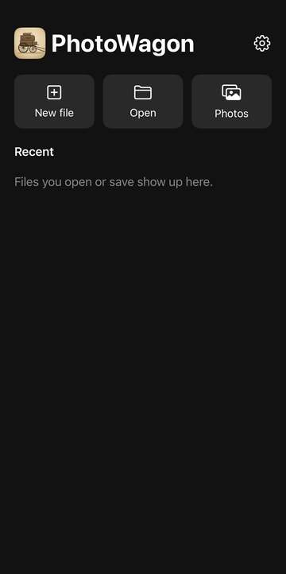
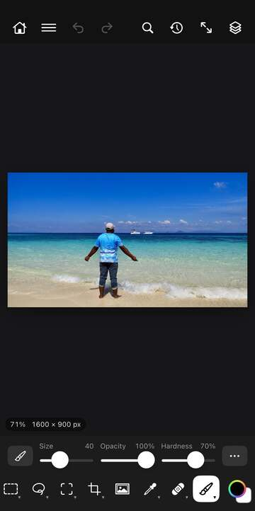
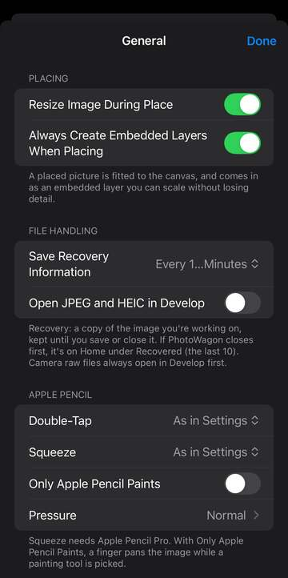

# The Basics

## Home

Home is the first screen you see. It's where you start a new image, open one, or pick up where you left off.

**New file** starts a blank image. Pick a **Preset** (Photo, Print, Art & Illustration, Web, Mobile, Film & Video) or choose Custom and set it up yourself, then tap Create. Options: *Name*, *Units* (Pixels, Inches or Centimeters), *Width* and *Height*, *Resolution (pixels/inch)*, *Colour Mode* (RGB Color, Grayscale, CMYK Color, Lab Color), *Colour Profile*, *Bit Depth* (8, 16 or 32 bit), *Background* (White, Black, Background Color, Transparent).

**Open** shows the images in PhotoWagon's own folder (On My iPhone › PhotoWagon in the Files app). Tap one to open it, or tap **Browse Files…** to look anywhere in Files, or **Photos…** to pick from your photo library. PhotoWagon opens JPEG, PNG, HEIC, JPEG XL, TIFF, PSD, WebP, GIF, camera raw files and its own layered files, among others.

**Photos** goes straight to your photo library.

**Open** (the list under the buttons) shows the images you already have open. Tap one to go back to it. **Back to Workspace**, under the title, also takes you back to the image you were working on.

**Recovered** appears only if PhotoWagon closed before you saved your work. Tap a row (or its **Open**) to open that copy, or tap **Discard** to throw it away. Home keeps the 10 newest copies and removes older ones.

**Recent** lists the files you opened or saved lately, with a small preview. Tap one to open it again.

**Preferences** is the gear at the top right. See Preferences below.

You can also drag an image from another app onto PhotoWagon to open it. Drop it on the canvas instead and it becomes a new layer.

## The editing screen

In portrait, the screen has the top bar, the canvas (your image), the options bar, and the toolbar along the bottom. Turn your device sideways and the tools move to a column on the left, with the options bar along the top.

**Document tabs** appear under the top bar when you have more than one image open. Tap a tab to switch. A dot after the name means unsaved changes. Tap ✕ to close it, and choose Save, Don't Save or Cancel if it has changes. On a phone held sideways, the tabs sit in the top bar.

**The options bar** shows the settings of the tool you picked, or buttons for what you can do right now, like Commit and Cancel while you crop or transform.

**The toolbar** holds the tools. Tap an icon to pick it. Icons with more than one tool show that group's tools in the options bar, so you can pick the one you want. Touch and hold an icon to see tool names and what they do.

**The status bar** sits at the bottom left of the canvas. It shows the zoom and one fact about your image. Tap it to choose which fact: *Document Dimensions*, *Layer Count* or *Current Tool*. While you record an action, it also says so.

### The top bar

**Home** (the house) takes you back to Home. Your open images stay open.

**☰** opens the menus: File, Edit, Image, Layer, Type, Select, Filter, View, Window and Help. **Quick Share as PNG…** sits at the top for sharing your image fast.

**Undo** and **Redo** (the curved arrows) step back and forward through your changes.

**Search Commands** (the magnifying glass) finds any command by name. See below.

**History** (the clock) lists every step you've taken. Tap any step to go back to it. Steps after it turn grey, and you can tap one of those to go forward again.

**View** (the arrows pointing out) helps when you've lost your place. Options: *Reset Tilt* (turns the image level again), *Reset Position* (puts it back in the middle), *Reset Zoom* (back to the size that fits, keeping any tilt), *Fit to Screen* (fits the whole image, level and centred).

**Layers** (the stacked squares) opens the Layers panel.

## Moving around the canvas

**Pinch** with two fingers to zoom in and out. **Drag with two fingers** to move the image around.

**Twist two fingers** to turn the image, like turning a sheet of paper. On a level image nothing happens until you twist past about 20°, so pinching won't tilt it by accident. Once it's turned, it follows your fingers right away. Use View › Reset Tilt to level it again.

**Tap with two fingers** to undo. **Tap with three fingers** to redo.

With a trackpad or mouse, scroll to move the image, and hold ⌥ or ⌘ while you scroll to zoom. Trackpad pinch and twist work too.

## Colours

**The colour well** sits at the end of the toolbar. The front square is the foreground colour (what you paint with). The square behind it is the background colour, a second colour some tools and fills use. Tap the front square to choose a new foreground colour. Tap the back square to swap the two. To pick a colour from your image, use the Eyedropper tool.

## Search Commands

**Search Commands** lists every command PhotoWagon has. Start typing a name, like "blur" or "crop", and tap the one you want. Each row shows which menu it lives in. Commands that need settings ask for them first. If a command can't run right now, it's greyed out with a short reason in orange.

## Help

**Help › Manual** opens this manual.

**Help › Tutorial** runs a short tour of 11 tips: the tools, a group's tools, tool options, the top bar buttons and the colours. Tap **Next** to move on, or **Skip Tutorial** to stop. The tour starts by itself the first time you open an image, and once you finish or skip it, it only comes back from the Help menu. It needs an open image.

**Help › Acknowledgements** (also at the bottom of Settings on the Home screen) lists the open-source software inside PhotoWagon, with each licence.

## Preferences

Open Preferences from the gear on Home, or from ☰ › Edit › Preferences › General….

**Placing** controls what happens when you add a picture to your image with Place. Options: *Resize Image During Place* (fits the picture to your canvas), *Always Create Embedded Layers When Placing* (brings it in as an embedded layer you can resize without losing detail).

**File Handling** covers safety copies and opening photos. Options: *Save Recovery Information* (how often PhotoWagon keeps a safety copy of unsaved work: Off, Every Minute, or every 5 to 60 minutes; 10 minutes to start), *Open JPEG and HEIC in Develop* (opens these photos in Develop first; camera raw files always do).

**Apple Pencil** sets how your Pencil behaves. Options: *Double-Tap* and *Squeeze* (what each does: As in Settings, Switch to Eraser, Previous Tool, Show Colors, Brush Settings, Undo or Off; Squeeze can also Show Palette and needs Apple Pencil Pro), *Only Apple Pencil Paints* (your finger moves the image while a painting tool is picked), *Pressure* (see below).

**Pressure** sets how hard you need to press for a full stroke. Pick *Light*, *Normal* or *Firm*, or drag the curve yourself: up for a lighter touch, down for a firmer one. Drag a point off the graph to remove it.

**AI** shows whether the AI Remove model is on your device. Options: *Download Model*, *Cancel Download* (while it downloads), *Delete Model* (frees about 25 MB; it downloads again next time you use AI Remove). The model runs on your device, so your photos never leave it.

The other items under ☰ › Edit › Preferences have no settings screen yet.

## Apple Pencil

PhotoWagon reads your Pencil's **pressure**, **tilt** and, on Apple Pencil Pro, **barrel roll** (turning the Pencil in your fingers). Brushes can use these to change size, opacity and angle as you paint; you set that up in Brush Settings. Fingers paint at full pressure.

**Hover** your Pencil over the screen (on iPads that support it) to see the brush outline before you touch down.

**Double-tap** and **squeeze** run the actions you chose in Preferences. *As in Settings* follows your iPad's own Apple Pencil settings.

**The palette** appears beside your Pencil when you squeeze (with Squeeze set to Show Palette). It has the Brush, Eraser, Smudge and Eyedropper, your foreground colour, Size and Opacity sliders, and Undo and Redo. Tap anywhere else to close it.

## Keyboard shortcuts

With a hardware keyboard attached, these are the most useful keys.

**Files and editing**: ⌘N New, ⌘O Open, ⌘S Save, ⇧⌘S Save As, ⌘W Close, ⌘Z Undo, ⇧⌘Z Redo, ⌘X Cut, ⌘C Copy, ⌘V Paste, ⌘J Layer via Copy, ⌘T Free Transform, ⌘F Search Commands, ⌘K Preferences.

**Selections**: ⌘A select all, ⌘D deselect, ⇧⌘I inverse, Q Quick Mask.

**View**: ⌘= zoom in, ⌘− zoom out, ⌘0 fit on screen, ⌘1 100%, F7 Layers. Hold Space and drag to move the image.

**Tools**: V Move, M Marquee, L Lasso, W selection tools, C Crop, I Eyedropper, B Brush, E Eraser, G Gradient, T Type, J repair tools, S Clone Stamp, O Dodge, P Pen, U shapes, H Hand, R Rotate View, Z Zoom. Press ⇧ with a tool's key to step through the tools that share it.

**Painting**: [ and ] make the brush smaller and bigger, and ⇧[ and ⇧] make it softer and harder. Number keys set opacity (1 is 10%, 0 is 100%, or type two quickly, like 4 then 5 for 45%); add ⇧ to set flow. Hold \` to erase with the brush until you let go. ← and → turn the brush tip. Caps Lock swaps the brush outline for a small crosshair.

**Colours**: X swaps foreground and background, D resets them to black and white.

**Finishing**: Return commits a crop, transform or shape in progress, and Esc cancels it.
