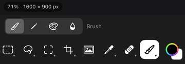
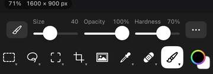
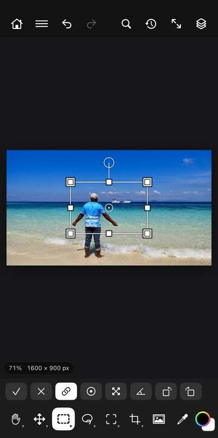
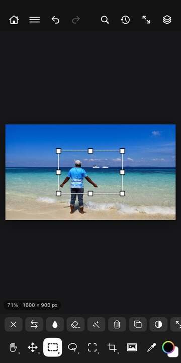
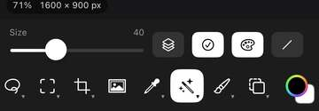
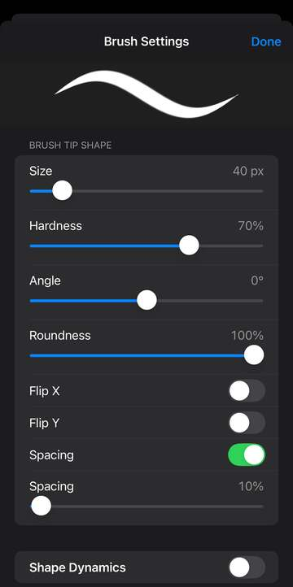

# Tools

The tool icons run along the bottom of the screen in the toolbar (down the left side when your iPad is sideways). Most icons hold a small group of related tools, marked by a tiny triangle in the corner. Tap a group's icon to pick its current tool and list all of its tools in the options bar (the row above the toolbar). Tap one there to pick it. Touch and hold a group's icon for a menu of its tools with a short description of each, or touch and hold any icon in the options bar to see its name. Once you've picked, tap the image and the options bar goes back to showing the tool's options.

A few things work the same with every tool:

**Moving around.** Pinch with two fingers to zoom, drag with two fingers to pan, and twist two fingers to turn the view (it starts turning once you twist past a small amount). Tap with two fingers to undo, and with three fingers to redo.

**The loupe.** When a tool places an exact point (a corner, a colour sample, a path point), a magnifier shows the pixels under your finger. It stays a moment after you lift so you can see where the point went.

**Touch and hold to pick a colour.** With painting tools, touch and hold the image to pick the colour under your finger as the foreground colour. With Clone Stamp and Repair Brush, touch and hold sets the source instead.

**Painting on text or shapes.** If you paint on a type, shape, fill or embedded layer, PhotoWagon asks whether to Rasterize it first, which turns it into plain pixels.

## View tools

**Hand** lets you drag with one finger to move around the image. Touch and hold the group's icon (or open its tools in the options bar) for three view shortcuts: *Fit on Screen* (show the whole image), *Actual Size* (one image pixel per screen pixel) and *Straighten View* (undo the view's rotation).

**Rotate View** turns the view as you drag around the screen, without changing the image. Use Straighten View to set it back.

**Zoom In** zooms in where you tap, or zooms to fit a box you drag. Options: *Scrubby Zoom* (instead of a box, drag right to zoom in and left to zoom out).

**Zoom Out** zooms out where you tap.

## Move and Artboard

**Move** drags the active layer around. The layer snaps to the canvas edges and centre, with guide lines showing where. Options: *Auto-Select* (picks the layer under your finger before moving it), *Copy While Moving* (moves a copy and leaves the original), *Align* (lines up the layer with the canvas's Left Edges, Horizontal Centers, Right Edges, Top Edges, Vertical Centers or Bottom Edges, or with the selection if there is one), *Free Transform* (puts handles round the layer, see below).

**Artboard** makes a new artboard where you drag a box.

### Free Transform

Free Transform puts a box with handles round the layer or selection. Drag inside the box to move it, drag a corner to scale it, and drag the round handle on top (or anywhere outside the box) to rotate it. The small dot in the middle is the reference point: drag it to change what the layer turns and scales around. Tap *Commit* (✓) to apply or *Cancel* (✕) to throw it away.

Options: *Keep Proportions* (corners scale without stretching), *Reference Point* (move the reference point to a corner, edge or the centre), *Scale From Reference Point* (scale around the reference point instead of the opposite corner), *Snap Rotation to 15°*, *Rotate 90° Left*, *Rotate 90° Right*, an angle box (type an exact angle), *Flip Horizontal*, *Flip Vertical*.

## Marquee tools

These select regular shapes. Like all selection tools, they have three mode buttons at the start of the options bar: *Replace* (a new selection), *Add* (adds to the selection) and *Subtract* (takes away from it).

**Rectangular Marquee** selects a rectangle you drag. After you draw it, drag its edges or corners to adjust it, or drag inside to move it. A tap on the image deselects. Options: mode, *Feather* (softens the edge by this many pixels), *Anti-alias* (smooths jagged edges). While the box is showing you also get *Lock Ratio* and *X*, *Y*, *W*, *H* boxes to type its exact position and size.

**Elliptical Marquee** works the same way but selects an oval. Same options as Rectangular Marquee.

**Single Row Marquee** and **Single Column Marquee** select one row or one column of pixels across the whole image where you tap. Options: mode, *Subject*, *All* (selects the whole image).

## Lasso tools

**Lasso** selects a freehand shape. Draw round the area with your finger and lift to close it. Options: mode, *Feather*, *Anti-alias*.

**Polygonal Lasso** selects a shape with straight sides. Tap each corner, then tap the first point (or tap *Commit*) to close it. Drag a point to move it. Options while drawing: *Commit*, *Cancel*, *Undo Last Point*. Before you start: mode, *Feather*, *Anti-alias*.

**Magnetic Lasso** follows edges for you. Trace roughly along the edge of an object and lift; the outline snaps to the edge it finds. Options: mode, *Subject*, *All*.

## Object Selection, Quick Selection and Magic Wand

**Object Selection** finds an object for you. Tap an object, or drag a box round it. With Object Finder on, touch and hold to highlight the object under your finger, then lift to select it. Options: mode, *Object Finder* (highlights objects as you hold), *Show All Objects* (shows every object it can find), *Subject* (selects the main subject of the photo).

**Quick Selection** grows a selection as you paint over an area; it spreads to similar colours and stops at edges. Use the Subtract mode to paint parts back out. Options: mode, *Size*, *Sample All Layers* (looks at every layer, not only the active one), *Enhance Edge* (a smoother, cleaner edge), *Subject*. You can also touch and hold the group's icon for *Select Subject*.

**Magic Wand** selects colours like the one you tap. Options: mode, *Tolerance* (how different a colour can be and still be picked, 0 to 255), *Contiguous* (only touching pixels; off picks that colour everywhere), *Sample All Layers*.

**Select Subject** (the *Subject* button) looks at the photo and selects the main subject, such as a person, pet or product. It uses the active layer unless Sample All Layers is on.

Every selection tool's options also have **Select All**, and **Paste** once you've copied something.

### When something is selected

Once there's a selection, and you're using a selection tool, a type tool, Move, Patch or Move and Fill, the options bar shows buttons for it instead.

**Deselect** removes the selection. **Invert** selects everything that wasn't selected. **Fill** fills the selection with the foreground colour. **Quick Fill** deletes what's inside and fills it from the area around it. **AI Remove** fills it with the on-device AI (see AI Remove below). **Delete** clears what's inside to transparent. **Copy** copies the selected part. **Paste** pastes what you copied as a new layer, in this image or another open one: switch to its tab first. **Select All** selects the whole image. **Copy to Layer** copies the selected part to a new layer. **Mask** adds a layer mask that shows only the selection. **Transform** starts Free Transform on the selected part.

## Crop and Slice tools

**Crop** trims the image. Drag to draw the crop area, or tap for the whole image. Drag a corner or edge to resize it (drag past the image to add canvas), and drag inside to move it. Parts outside are dimmed. Tap *Commit* to crop or *Cancel* to stop. Options: *Straighten* (draw a line along something that should be level, and the crop turns to match), *Delete Cropped Pixels* (off keeps the cut-away parts hidden, so you can move them back in later).

**Perspective Crop** crops and squares up something photographed at an angle, such as a sign or a page. Tap its four corners (drag one to move it), then tap *Commit*. Options while placing: *Commit*, *Cancel*, *Undo Last Point*.

**Slice** cuts the image into slices for the web. Drag a box to make a slice.

**Slice Select** shows the name and number of the slice you tap.

## Frame

**Frame** makes a picture frame layer where you drag a box.

## Measuring tools

**Eyedropper** picks the foreground colour from the image. Tap, or drag to see the colour change as you go. Options: *Sample Size* (*Point Sample*, or an average of 3 by 3 up to 101 by 101 pixels), *Sample* (*All Layers*, *Current Layer*, *Current & Below*, and the same two without adjustment layers).

**Color Sampler** marks a spot so you can read its colour. Tap to add a sampler; a message shows its number and its R, G and B values. Drag a sampler to move it.

**Ruler** measures distance and angle. Drag a line; the options bar shows its width (W), height (H), length (L) in pixels and angle (A). Drag either end to change it.

**Note** adds a note to the image. Tap where you want it and type your note.

**Count** puts numbered count marks on the image. Tap each thing you want to count; a message shows the total.

## Repair tools

**Spot Repair Brush** fixes small spots and blemishes. Paint over them and they're filled to blend with what's around. Options: *Size*, *Hardness*, *Sample All Layers*, *Straight Line* (see below).

**Quick Fill** removes something by filling it from the surroundings, with no AI. Paint over it and lift. Options: *Size*, *Sample All Layers*, *Remove After Each Stroke* (on: each stroke is filled when you lift; off: paint several strokes, then tap *Commit* to fill them all at once), *Straight Line*.

**AI Remove** removes things with an AI model that fills the gap with what should be behind it. It runs on your device, so your photos never leave it. Paint over what you want gone, or select it and tap *Remove Selection*. Options: *Size*, *Sample All Layers*, *Remove After Each Stroke* (as for Quick Fill), *Match Colour* (blends the fill into the colour round it), *Remove Selection* (shown when something is selected), *Straight Line*.

The first time you use AI Remove, PhotoWagon asks to download its model (about 25 MB, once). Tap *Download* to get it, or *Not Now*. When the download finishes, what you painted or selected is removed.

**Repair Brush** copies texture from one place to cover another, matched to the light and colour where you paint. Touch and hold to set the source, then paint over the problem. Options: *Size*, *Opacity*, *Hardness*, *Straight Line*.

**Patch** repairs a selected area with texture from somewhere else. Select the area first (with any selection tool), switch to Patch, then drag from the selection to a clean area to take the patch from.

**Move and Fill** moves a selected part of the image and fills the hole it leaves. Select it, switch to Move and Fill, then drag it to where you want it.

**Red Eye** fixes red eyes from a camera flash. Tap each red eye.

## Brush tools

**Brush** paints with the foreground colour. Paint with your finger or Apple Pencil; pressure works with the Pencil.

Options: *Brush Tip* (pick a brush preset from its groups, or *Import Brush Tips…*), *Mode* (how the paint blends with what's below, such as Normal, Multiply or Screen), *Size*, *Opacity*, *Hardness*, *Flow* (how much paint each dab lays down), *Smoothing* (evens out shaky strokes), *Pressure for Size*, *Pressure for Opacity* (the Pencil's pressure changes size or opacity), *Symmetry* (*Off*, *Vertical*, *Horizontal*, *Dual Axis*, *Diagonal*: paints a mirror image across the middle of the canvas), *Brush Angle* (the angle dial), *Brush Settings* (the full brush screen), *Straight Line*.

On a narrow screen only the sliders that fit are shown, and the rest move into the *Brush Options* (…) menu: Mode, the two pressure buttons, Symmetry, Straight Line, Brush Angle… and Brush Settings….

**Straight Line.** With Straight Line on (or Shift held on a keyboard), a tap paints a straight line from where your last stroke ended to where you tap. It works with every painting and retouching tool.

**Pencil** paints hard-edged lines. Options: as for Brush, without Hardness and Flow.

**Color Replacement** paints the foreground colour over the colours you paint on, keeping their light and shade. Options: *Size*, *Straight Line*.

**Mixer Brush** paints colour that mixes with the colours already there, like wet paint. Options: *Size*, *Flow*, *Smoothing*, *Pressure for Size*, *Pressure for Opacity*, *Brush Angle*, *Brush Settings*, *Straight Line*.

### Brush Angle

The Brush Angle dial shows the brush tip's shape at its angle. Drag round the dial to turn it, or tap the turn buttons to move it 15° either way. *Reset* sets it back to 0°.

### Brush Settings

Brush Settings opens a screen with every setting of the brush, with a preview stroke at the top that updates as you change things. Tap *Done* when you're finished.

**Brush Tip Shape.** *Size*, *Hardness*, *Angle*, *Roundness* (squashes the tip into an oval), *Flip X*, *Flip Y*, *Spacing* (on: sets the gap between dabs).

**Shape Dynamics** (turn on with its switch). *Size Jitter* with *Minimum Diameter*, *Tilt Scale*, *Angle Jitter*, *Roundness Jitter* with *Minimum Roundness*, *Flip X Jitter*, *Flip Y Jitter*. Each jitter adds random change as you paint.

**Scattering** (turn on with its switch). *Scatter* (spreads dabs away from the stroke), *Both Axes*, *Count* (dabs per step), *Count Jitter*.

**Transfer** (turn on with its switch). *Opacity Jitter* and *Flow Jitter*, each with a *Minimum*.

Each jitter has a *Control* that sets what drives it: *Off*, *Fade*, *Pen Pressure*, *Pen Tilt*, *Pencil Rotation*, *Initial Direction* or *Direction*.

**Flow and Smoothing.** *Flow*, *Smoothing*, *Pulled String Mode* (the stroke only moves once your finger pulls past a short string), *Stroke Catch-up*, *Catch-up on Stroke End*, *Adjust for Zoom*.

**Other settings.** *Noise* (adds grain to soft edges), *Wet Edges* (darker edges, like watercolour), *Build-up* (paint keeps building while you hold).

**New Brush Preset…** saves the brush under a name you give, so it shows up in the Brush Tip menu. *Include Tool Settings* also saves the mode, opacity, flow and the pressure buttons with it.

## Stamp tools

**Clone Stamp** paints a copy of one part of the image onto another. Touch and hold to set the source, then paint; if no source is set yet, PhotoWagon reminds you. Options: as for Brush, without Brush Tip, Mode and Symmetry.

**Pattern Stamp** paints with a pattern. Options: as for Clone Stamp.

## History Brush

**History Brush** paints part of the image back to how it was earlier, so you can undo an edit in one area only. Options: as for Clone Stamp.

## Eraser tools

**Eraser** erases to transparent as you paint. Options: as for Brush, without Mode.

**Background Eraser** erases the colour you paint over while leaving other colours, handy for removing a plain background round an edge. Options: *Size*, *Hardness*, *Straight Line*.

**Magic Eraser** erases all colours like the one you tap. Options: *Tolerance*, *Contiguous*, *Sample All Layers*.

## Gradient and Paint Bucket

**Gradient** fills the layer with a smooth blend of colours. Drag from where it starts to where it ends. Options: *Gradient* (pick a gradient preset; the default is Foreground to Background), the style (*Linear*, *Radial*, *Angle*, *Reflected*, *Diamond*), *Reverse* (swaps the ends).

**Paint Bucket** fills colours like the one you tap with the foreground colour. Options: *Tolerance*, *Contiguous*, *Sample All Layers*.

## Blur, Sharpen and Smudge

**Blur** softens detail where you paint. Options: *Size*, *Strength*, *Hardness*, *Straight Line*.

**Sharpen** makes detail crisper where you paint. Options: as for Blur.

**Smudge** smears colour along your stroke, like a finger in wet paint. Options: as for Blur.

## Dodge, Burn and Sponge

**Dodge** lightens where you paint. Options: *Size*, *Exposure* (how strong each stroke is), *Hardness*, *Straight Line*.

**Burn** darkens where you paint. Options: as for Dodge.

**Sponge** takes colour out where you paint. Options: *Size*, *Flow*, *Hardness*, *Straight Line*.

## Pen tools

The pen tools draw a path, a smooth outline you can turn into a selection, a fill, a stroke or a shape. All of them share these options: *Make Selection* (selects the inside of the path, using the selection mode), *Fill Path* (fills it with the foreground colour), *Stroke Path* (paints along it with the brush), *Shape Layer* (makes it a new shape layer), *Delete Path*.

**Pen** draws a path point by point. Tap for a corner, or drag to pull out handles for a curve. Tap the first point to close the shape.

**Freeform Pen** draws a path as you move your finger, like drawing with a pencil.

**Curvature Pen** makes smooth curves. Tap points and the path curves through all of them.

**Add Anchor Point** adds a point where you tap on a path.

**Delete Anchor Point** removes the point you tap.

**Convert Point** changes the point you tap from a corner to a smooth curve, or back.

## Type tools

**Horizontal Type** adds text. Tap for a line of text, or drag a box for text that wraps inside it. Type your text and confirm. Tap existing text to edit it. The text uses the foreground colour. Options: *Font*, *Size* (in points), *Leading* (the gap between lines; empty is Auto), *Tracking* (the space between letters), and left, centre or right alignment. With a text layer active, changes apply to it straight away.

**Vertical Type** adds text that runs top to bottom. Options: as for Horizontal Type.

**Horizontal Type Mask** and **Vertical Type Mask** make a selection in the shape of the letters you type, instead of a text layer. Options: as for Horizontal Type.

## Path selection tools

**Path Selection** moves a whole path. Drag it where you want it.

**Direct Selection** changes a path's shape. Drag a point to move it, or drag a handle to change the curve. Options for both: as for the pen tools.

## Shape tools

Each shape tool draws a new shape layer filled with the foreground colour. Drag to draw the shape; hold Shift on a keyboard for an even square or circle.

**Rectangle** draws a rectangle. **Ellipse** draws an oval. **Triangle** draws a triangle.

**Polygon** draws a shape with straight sides. Options: *Sides* (3 to 100).

**Line** draws a straight line from where you start dragging to where you stop. Its thickness depends on how far you're zoomed in.

**Custom Shape** draws a ready-made shape from the shape presets.

## Fluid Warp

**Fluid Warp** (☰ › Filter › Fluid Warp…) lets you push and pull the pixels of a layer by painting on the image. Drag to warp; two fingers still zoom and pan. Tap *Commit* to apply or *Cancel* to stop. Options: the warp tool (*Forward Warp* pushes pixels along, *Reconstruct* paints back towards the original, *Smooth*, *Twirl*, *Pucker* pulls in, *Bloat* pushes out), *Size*, *Pressure*, and under *More*, *Amount* (how much of the warp shows, 0 to 100%) and *Restore All* (removes every warp stroke).
