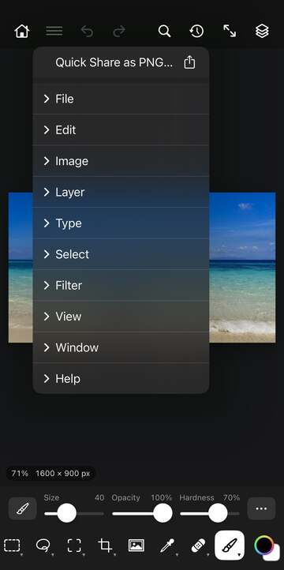
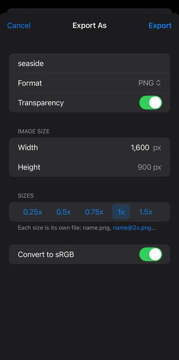
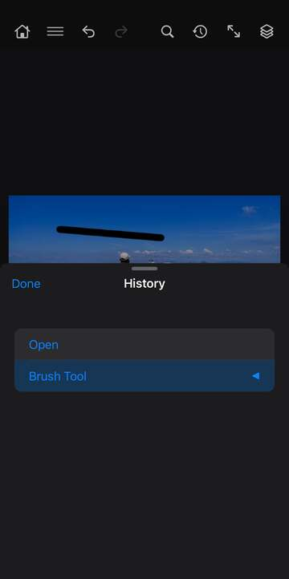

# File, Edit, View and Window

Tap ☰ at the top left to open the menus. This section goes through File, Edit, View and Window from top to bottom, in the order you see them. A greyed-out item tells you, in small print under its name, what it needs first.

At the very top of ☰, above the menus, **Quick Share as PNG…** opens the share sheet with a PNG of your image, ready to send.

Items whose names end in "…" open a settings sheet first. Change what you need, then tap **OK** to run it, or **Cancel** to leave things as they were.

## File

New, Open and your recent files are on Home (the house at the top left).

**New…** (Home › **New file**) makes a blank document. Pick a *Preset* (Photo, Print, Art & Illustration, Web, Mobile, Film & Video) or set the size yourself. Options: *Name*, *Units* (Pixels, Inches, Centimeters), *Width*, *Height*, *Resolution (pixels/inch)*, *Colour Mode* (RGB Color, Grayscale, CMYK Color, Lab Color), *Colour Profile*, *Bit Depth* (8, 16 or 32 bit), *Background* (White, Black, Background Color, Transparent). Tap **Create**.

**Open** (on Home) lists the pictures in On My iPhone › PhotoWagon, newest first. Tap one to open it. **Browse Files…** lets you pick from anywhere in Files, and **Photos…** from your photo library. You can open JPEG, PNG, HEIC, JPEG XL, TIFF, PSD, WebP, GIF, BMP, SVG, EXR, camera raw files and more. A JPEG XL file made of layers opens with its layers, and an animated one with a layer per frame.

**Photos** (on Home) goes straight to your photo library and opens the picture you pick as a new document.

**Recent** (on Home) lists the files you've opened or saved lately (up to 20). If a file has moved or been deleted, the app tells you it can't be found.

**Close** closes the document in front. If it has changes you haven't saved, you're asked first: **Save**, **Don't Save** or **Cancel**.

**Save** writes your changes back into the document's own file. If the document is new, or its file can't hold layers (a JPEG with several layers, say), Save As opens instead.

**Save As…** saves the document as a new file, and from then on you're working in that file. Options: *Name*, *Format*, *Where* (On My iPhone › PhotoWagon, or Other Location… to choose a folder). The formats that keep layers are PhotoCraft (the default), PSD and TIFF. A one-layer document can also go out as JPEG, PNG, WebP, JPEG XL, GIF or BMP. JPEG adds a *Quality* slider from 0 to 12. JPEG XL adds *Lossless* (on: every pixel kept exactly, at its full depth), *Quality* from 1 to 100 when Lossless is off, and *Effort* from 1 to 10 (higher takes longer and makes a smaller file); its alpha channels go into the file too.

**Save a Copy…** works like Save As, with every format on offer, but your document stays in its own file. Use it for a quick JPEG or PNG of a layered piece.

**Place Embedded…** adds a picture from a file as a new layer, then opens Free Transform so you can size and position it. Tap **Select** to pick several files, then **Place** to add them all at once, each a layer named after its file.

**Place from Photos…** does the same with a picture from your photo library.

**Share** sends a flat copy of your image as a **JPEG** or **PNG** through the share sheet (Messages, Mail, AirDrop and so on).

**Export** holds three ways to save flat copies in On My iPhone › PhotoWagon:

- **Quick Export as PNG** saves a PNG straight away, named after the document.
- **Export As…** saves one or more copies at the sizes you choose. Options: *Name*, *Format* (PNG, JPEG, WebP, JPEG XL, GIF), *Lossless* (JPEG XL), *Quality* (1 to 100, for JPEG, WebP and lossy JPEG XL), *Transparency* (off fills see-through areas with white; JPEG is always filled), *Width* (the height follows), *Sizes* (0.25x to 3x; each size is its own file, such as name@2x.png), *Convert to sRGB*.
- **Save for Web…** makes a small file for the web, with a preview and the file size it will come to. Options: *Name*, *Format* (GIF, PNG-8, PNG-24, JPEG), *Colour Reduction* (Perceptual, Selective, Adaptive, Restrictive), *Colours* (2 to 256), *Dither* (Diffusion, Pattern, Noise, No Dither), *Quality* (JPEG), *Transparency*, *Percent* (the size), and for an animation, *Looping* (Once, 3 Times, Forever).

**Save to Photos** puts a flat PNG of your image in your photo library. The first time, iOS asks if that's OK.

**Print…** opens the print dialog, with the image scaled to fit the page.

### Scripts

**Delete All Empty Layers** removes every layer with nothing on it. **Flatten All Layer Effects** bakes every layer's effects into its pixels. **Flatten All Masks** applies each pixel layer's mask to its pixels and removes the mask.

**Browse…** can't load a script on iPhone or iPad yet, so it does nothing useful here.

**Script Events Manager…** turns scripts that run on events on or off. Options: *Enabled* (scripts run on events), *Remove all* (clears every one). You can't add a new one from here.

### Automate

**Fit Image…** is meant to shrink or grow the image to fit a box, but the box's size can't be set here yet, so the image keeps its size. Options: *Dont enlarge*, *Resample*.

**Conditional Mode Change…** changes the document to another colour mode, whatever mode it's in now. Options: *To* (Rgb, Grayscale, Cmyk, Lab).

**Crop and Straighten Photos** finds each photo on a scan of several prints, straightens it and opens it as its own new document.

### Import

**Notes…**, **Video Frames to Layers…**, **WIA Support…** and **Variable Data Sets…** each need a file or device the app can't pick for them here, so they don't work on iPhone or iPad yet.

### Export (the second one)

A second Export submenu sits lower in File, below Import.

**Export Preferences…** sets what Quick Export and Export As start with. Options: *Quick export format* (Png, Jpg, Gif, Webp), *Quick export location*, *Jpeg quality*, *Webp lossless*, *Webp quality*, *Metadata* (None, Copyright, All), *Convert to srgb*. Export As changes these to match your last export.

**Render Video…** and **Data Sets as Files…** need a folder the app can't pick for them here, so they don't work yet.

### More File items

**New from Clipboard** makes a new document the size of what you last copied, holding it as one layer. It's greyed out until you've copied something.

**Revert** goes back to the last saved version of the file, as one step you can undo. If it's greyed out, tap the first step in the History panel instead.

**File Info…** adds details that are saved with the file. Options: *Title*, *Author*, *Author title*, *Description*, *Copyright*, *Copyright status* (Unknown, Copyrighted, Public domain), *Copyright url*. Fields you leave empty stay as they were.

## Edit

**Free Transform** puts a box with handles round the layer (or the selection). Drag inside to move it, drag a corner to scale, and drag the round handle (or outside the box) to rotate. The options bar has *Keep Proportions*, *Reference Point*, *Scale From Reference Point*, *Snap Rotation to 15°*, *Rotate 90° Left* and *Right*, an angle box, *Flip Horizontal* and *Flip Vertical*. Tap **Commit** or **Cancel**.

**Pin Warp** bends a layer by pins you put on it. Tap to add pins, then drag one to bend the layer round the others. In the options bar: *Mode* (Rigid, Normal, Distort), *Density* (Fewer, Normal, More Points), *Expansion*, *Show Mesh*, and for the pin you've tapped, *Rotate* and *Delete Pin*. It can't bend the locked Background.

**Define Brush Preset…** turns the selection into a brush tip: black paints, white is clear. Give it a name and tap **OK**. It's greyed out until you've made a selection. The same item appears again lower in Edit, asking for a *Name*.

**Import Brush Tips…** adds brushes from a brush file, or uses a picture as a tip. Pick from your PhotoWagon folder or tap **Browse Files…**.

### Paste Special

**Paste in Place** pastes what you copied at exactly the spot it came from. **Paste Into** pastes it as a new layer that only shows inside the selection (through a mask you can change later). **Paste Outside** does the opposite: it shows everywhere except the selection.

### Transform

**Again** repeats your last transform on the current layer, handy for stepping something along or turning it bit by bit.

**Rotate 180°**, **Rotate 90° Clockwise**, **Rotate 90° Counter Clockwise**, **Flip Horizontal** and **Flip Vertical** turn or flip the layer (or just the selected part of it) in one go.

**Warp**, **Split Warp Crosswise**, **Split Warp Horizontally**, **Split Warp Vertically** and **Remove Warp Split** can't be set up from this menu yet, so they don't change anything.

### Preferences

Edit › Preferences: see The Basics.

### Purge

Purge frees memory. **Undo** forgets the undo steps of the current document. **Clipboard** empties what you copied. **Histories** forgets the history of every open document. **Video Cache** has nothing to clear. **All** does all of these. None of them can be undone.

### Presets

**Preset Manager…** is meant to rename, delete or reorder your saved brushes, custom shapes and patterns. Options: *Action* (List, Rename, Delete, Move), *Kind* (Brushes, Custom shapes, Patterns), *Name*, *New name*. It can't pick which preset to change yet.

**Export/Import Presets…** and **Migrate Presets** need a file the app can't pick for them here, so they don't work yet.

### More Edit items

**Undo** steps back one change, and **Redo** puts it back. You can also jump to any step in the History panel.

**Fill…** fills the selection (or the whole layer) with a colour or pattern. Options: *Contents* (Foreground, Background, Color, Surroundings, Pattern, History, Black, Gray, White), *Color*, *Scale*, *Color adaptation*, *Mode* (Normal, Multiply), *Opacity*, *Preserve transparency* (only fill where there are already pixels).

**Clear** deletes the selected pixels, leaving them see-through. On the Background they become the background colour.

**Cut**, **Copy** and **Paste** work as you'd expect on the current layer's selected pixels. Paste puts what you copied on a new layer. With no document open, Paste makes a new document from it.

**Copy Merged** copies what you see in the selection, from all the visible layers at once, not only the current one.

**Toggle Last State** flips between your last change and the step before it, so you can compare before and after.

**Assign Profile…** tags the document with a different colour profile without changing its pixels, so the colours look different. Options: *Profile* (Working, Srgb, Display-p3, Adobe-rgb-compat, Prophoto-compat, Linear-srgb, Rec2020, Sgray, Dot-gain-20-compat, Lab-d50, Coated-cmyk, None).

**Convert to Profile…** changes the pixels to a new colour profile so the colours look the same. Options: *Profile* (the same list), *Intent* (Perceptual, Relative, Saturation, Absolute), *Bpc* (black point compensation).

**Color Settings…** sets how the app handles colour profiles. Options: *Working rgb*, *Working gray*, *Policy rgb*, *Policy cmyk* and *Policy gray* (Preserve, Convert, Off), *Ask on mismatch*, *Ask on paste*, *Ask on missing*, *Intent*, *Blend text gamma*, *Bpc*, *Dither*, *Monitor profile*, *Reset* (back to the defaults).

**Stroke…** draws a line round the selection. Options: *Width* (1 to 250 px), *Color*, *Location* (Inside, Center, Outside), *Opacity*, *Preserve transparency*.

**Check Spelling…** looks for spelling mistakes in your text layers. Options: *Action*, *All layers*, *Suggestions*. It doesn't show what it finds yet.

**Keyboard Shortcuts…**, **Menus…** and **Toolbar…** are meant for changing shortcuts, menu items and the toolbar, but they can only reset them from here.

**Fade…** softens the filter, adjustment or brush stroke you've just done, or blends it differently. Use it straight after, before anything else. Options: *Opacity*, *Mode* (Normal, Multiply, Screen, Overlay, Soft light, Hard light, Darken, Lighten, Difference, Color, Luminosity).

**Fill from Surroundings…** fills the selection with picture made up from what's around it, to remove something. Select round the thing first. Options: *Sampling* (Auto, Rectangular), *Sample all layers*, *Color adaptation*, *Rotation adaptation*, *Scale*, *Mirror*, *Output* (Current, New, Duplicate layer).

**Content-Preserving Scale** stretches or squeezes a layer while trying to keep its important parts the same shape. From the menu it runs at full size, so nothing changes yet.

**Define Custom Shape…** saves the current path or shape as a custom shape you can draw again with the shape tools. Options: *Name*.

**Find and Replace Text…** finds words in your text layers and swaps them. Options: *Find*, *Replace*, *Action* (Change all, Find, Change, Change find), *Case sensitive*, *Whole word*, *Forward*, *All layers*.

**Auto-Align Layers…** lines up layers of the same scene, such as photos for a panorama or a group shot. Select two or more layers first. Options: *Projection* (Auto, Perspective, Cylindrical, Spherical, Collage, Reposition), *Geometric correction*, *Interpolation*, *Registration*.

**Auto-Blend Layers…** blends aligned layers into one smooth picture. Options: *Method* (Panorama, or Stack for combining sharp parts of shots focused differently), *Seamless tones*, *Halo control*, *Depth map*.

**Define Pattern…** saves the selection (or the whole image) as a pattern for Fill and the pattern tools. Options: *Name*.

**Perspective Warp** can't be set up from this menu yet, so it does nothing useful here.

## View

**Zoom In** and **Zoom Out** zoom the canvas in steps. You can also pinch.

**Fit Layer(s) on Screen** zooms so the current layer fills the view.

**Snap** (ticked when on) makes a layer you're moving snap to the canvas edges and centre. It's on to start with.

**Fit on Screen** shows the whole image. **Actual Size** shows one image pixel per screen pixel. **Straighten View** undoes any turn you've given the view with two fingers.

**Canvas Colour** sets the colour round your image: Default, Black, Dark Gray, Medium Gray, Light Gray, White or Custom… (pick any colour).

### Proof Setup

These preview the image a different way and turn Proof Colors on. **Working Cyan Plate**, **Working Magenta Plate**, **Working Yellow Plate** and **Working Black Plate** show one printing ink on its own, and **Working CMY Plate** shows the three colour inks without black. **Legacy Macintosh RGB** shows how it would look on an older Mac screen.

**Color Blindness (Protanopia-type and Deuteranopia-type)** show roughly how the image looks to people with two common kinds of colour blindness. They're handy for checking that labels and charts still read well.

### More View items

**New Guide…** adds a guide line. Options: *Orientation* (Horizontal, Vertical), *Position*, *Color*. Guides are saved with the file, but the app doesn't draw them on the canvas yet.

**Clear Guides** removes every guide.

**Proof Colors** (on or off) previews the image as it would print, using the proof setup.

**Gamut Warning** (on or off) marks the colours that won't print as they look on screen.

**New Guide Layout…** adds rows and columns of guides in one go. Options: *Columns*, *Gutter*, *Rows*, *Center columns*, *Clear existing*, *Target* (Document, Selected artboards).

**New Guides From Shape** adds guides along the edges of the selected shape layer.

**Clear Canvas Guides** removes the guides that aren't on an artboard. **Clear Selected Artboard Guides** removes the guides inside the current artboard.

**32-bit Preview Options…** sets how a 32-bit image shows on screen. It doesn't change the image. Options: *Method* (Exposure gamma, Highlight compression), *Exposure*, *Gamma*.

**Lock Slices** (on or off) stops slices from being moved by mistake. **Clear Slices** deletes every slice.

## Window

**Layers**, **Properties** and **Adjustments** open those panels. They're covered in "Layers".

**History** lists every change you've made to the document, oldest at the top. The current step is highlighted. Tap any step to go back to it. Steps after it turn grey, and you can tap one to go forward again, until you make a new change. Tap **Done** to close the panel.

**Actions** records a run of steps so you can play them again on another image. Along the top:

- **New Action** (+) asks for a name, then starts recording. Work on your image, then come back and tap **Stop Recording**.
- **Record** adds more steps to the action you've tapped.
- **Play** runs the action you've tapped. If a step fails, the app tells you which one and why.
- **Delete** removes the action you've tapped.

Actions are listed in sets. Tap the arrow next to an action to see its steps, and tick or untick an action or step to turn it on or off. Double-tap an action to rename it. The ⋯ menu has *Rename…*, *Add to Set…*, *Load Actions…* (open an actions file) and *Save Actions…* (save the set as a file in your PhotoWagon folder).

**Brush Settings** opens the full settings for the current brush, covered with the Brush tool.

**Timeline** (ticked when showing) docks a strip above the toolbar for making a frame animation, such as a GIF. Tap **Create Frame Animation** to start. Each frame remembers which layers show, how see-through they are and where they sit. The pixels are shared by every frame. Its controls:

- The looping menu on the left: *Once*, *3 Times*, *Forever* or *Other…*.
- **First Frame**, **Previous Frame**, **Play** (or **Stop**) and **Next Frame**.
- **Duplicate Frame** adds a copy of the current frame after it. **Delete Frame** removes the selected frames.
- The ⋯ menu: *Make Frames From Layers* (one frame per layer), *Select All Frames*, *Reverse Frames*, *Delete Animation*, *Close Timeline*.

Tap a frame's thumbnail to go to it and change it. Under each one, tap its delay to choose how long it shows: 0.1 s to 10 s, or *Other…*. After Select All Frames, a delay you pick applies to all of them. To save the animation as a GIF, use File › Export › Save for Web… with GIF, and set *Looping* there.
