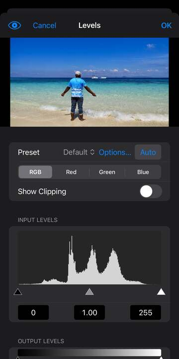
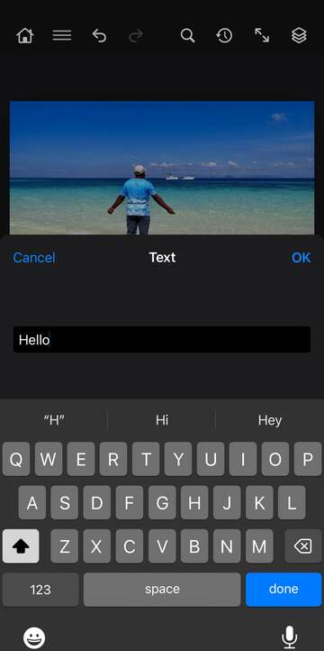

# Image, Select and Type

These three menus live under ☰ in the top bar. Image changes the whole picture (its size, colours and colour mode), Select makes and reshapes selections, and Type works on text layers.

Items whose name ends in "…" open a settings screen first. On iPhone it opens as a sheet with a small preview at the top. On iPad it opens in a column beside the canvas, so you see the change on the full image. Adjustments and Color Range show the result as you change their settings: tap the eye button to compare with and without, **OK** to keep the result, or **Cancel** to go back to how it was. Items without "…" run straight away, and you can always undo them.

In each menu, the submenus come first, then the other items.

## Image

### Image Rotation

**Flip Canvas Horizontal, Flip Canvas Vertical** mirror the whole image, all layers together, left to right or top to bottom.

**180°, 90° Clockwise, 90° Counter Clockwise** turn the whole image. Use them for a photo that came in sideways or upside down.

**Arbitrary…** turns the whole image by any angle, and the canvas grows to fit. Options: *Angle* (in degrees), *Direction* (Cw for clockwise, Ccw for counter clockwise), *Interpolation* (how new pixels are worked out: Bicubic is smoothest, Nearest keeps hard edges).

### Adjustments

Adjustments change the colours and tones of the active layer. If you'd rather keep the change separate and editable later, use an adjustment layer instead (Layer › New Adjustment Layer, or the Adjustments panel).

**Desaturate** removes all colour from the layer and leaves the greys. It runs straight away.

**Brightness/Contrast…** lightens or darkens the layer and adds or removes contrast. Options: *Brightness*, *Contrast*, *Legacy* (an older, stronger way of working that can clip bright and dark areas).

**Levels…** sets the darkest, middle and brightest tones over a histogram. Drag the handles under the histogram or type the numbers in *Input Levels* and *Output Levels*. Options: *Preset* (Default, Brighter, Darker, More Contrast, Strong Contrast, Lift Shadows, Soften Highlights, Faded), *Auto* (fixes the tones for you), *Options…* (opens Auto Options, below), *Channel* (work on all colours or one), *Show Clipping* (marks what turns pure black or white), and the eyedroppers *Set Black Point*, *Set Gray Point* and *Set White Point* (tap a spot in the image that should be black, neutral grey or white).

**Auto Options** (from Levels or Curves) chooses how Auto works. Options: *Algorithm* (Monochromatic Contrast, Per Channel Contrast, Find Dark & Light Colors), *Snap Neutral Midtones* (makes near-grey midtones truly grey), *Clip* *Shadows* and *Highlights* (how much of each end may turn pure black or white), *Save as Defaults*.

**Curves…** reshapes the tones with a curve. Tap the graph to add a point, drag points to bend the curve, and drag a point off the graph to remove it. Options: *Preset* (Default, Brighter, Darker, More Contrast, Strong Contrast, Lift Shadows, Faded, Negative), *Auto* and *Options…*, *Channel*, *Show Clipping*, points or pencil (draw the curve with your finger, then *Smooth* it), a grid size button, *Input* and *Output* for the chosen point, a bin to delete it, and the same three eyedroppers as Levels.

**Exposure…** corrects a photo that came out too dark or too light, working like a camera's exposure. Options: *Exposure* (in stops), *Offset* (lifts or lowers the darkest tones), *Gamma* (the midtones).

**Vibrance…** makes colours richer or calmer. Options: *Vibrance* (boosts dull colours more than strong ones, so skin stays natural), *Saturation* (changes all colours evenly).

**Hue/Saturation…** shifts colours, makes them stronger or weaker, and lightens or darkens them. Options: *Edit* (Master for all colours, or one colour range such as Reds or Blues), *Hue*, *Saturation*, *Lightness*, *Colorize* (tints the whole layer one colour; Master only), and for a colour range, *Range* sliders (*Fade from*, *From*, *To*, *Fade to*) that set which hues it covers.

**Color Balance…** pushes colours towards one side of a pair, for example to warm up shadows or cool down highlights. Options: *Tone* (Shadows, Midtones, Highlights), three sliders (Cyan to Red, Magenta to Green, Yellow to Blue), *Preserve Luminosity* (keeps brightness the same).

**Black & White…** turns the layer to greys and lets you choose how light each colour becomes, for example darker skies or brighter skin. Options: *Preset* and *Auto*, sliders for *Reds*, *Yellows*, *Greens*, *Cyans*, *Blues* and *Magentas*, *Tint* and *Tint Color* (for a sepia or toned look).

**Photo Filter…** lays a coloured filter over the layer, like one on a camera lens. Options: *Use* (Filter or Color), *Filter* (warming, cooling and colour filters such as Sepia and Underwater) or *Color* (your own), *Density* (how strong), *Preserve Luminosity*.

**Channel Mixer…** builds each colour channel from a mix of red, green and blue. It's good for custom black and white or for odd colour effects. Options: *Preset* (Default, Monochrome, Monochrome with a Red, Green or Blue filter, Swap Red and Blue), *Output Channel*, *Monochrome*, sliders for *Red*, *Green* and *Blue* with their *Total*, *Constant* (lightens or darkens the whole channel).

**Invert** turns the layer into its negative. It runs straight away.

**Posterize…** cuts the layer down to a few tones per colour, for a flat, poster-like look. Options: *Levels* (how many tones per colour).

**Threshold…** turns the layer into pure black and white, with no greys. Options: *Level* (pixels lighter than this turn white, darker ones black), shown over a histogram.

**Gradient Map…** maps the layer's tones onto a gradient: dark tones take the left colour and light tones the right. Options: *Colour Stops* (tap a stop to change its colour, move it, or *Add Stop*), *Presets*, *Reverse*, *Dither* (smooths banding).

**Selective Color…** changes how much cyan, magenta, yellow and black goes into one range of colours, such as only the reds or only the neutrals. Options: *Colors* (the range to change), *Cyan*, *Magenta*, *Yellow*, *Black*, *Method* (Relative changes by a share of what's there, Absolute by a fixed amount).

**Color Lookup…** gives the layer a ready-made colour grade. Options: *Lut* (None, Warm, Cool, Teal orange, Bleach bypass, Faded film, Day for night, Mono contrast, Cross process), *File*, *Interpolation* (Trilinear or Tetrahedral, two ways of blending between colours), *Dither*.

**Equalize** spreads the layer's tones evenly from black to white, which can bring out detail in a flat image. It runs straight away.

**Shadows/Highlights…** brings back detail in dark shadows and bright highlights without changing the middle tones much. Good for backlit photos. Options: *Shadow amount*, *Shadow tone*, *Highlight amount*, *Highlight tone*, *Radius* (the size of the area each pixel is compared with), *Color* (saturation), *Midtone* (contrast), *Black clip*, *White clip*.

**Replace Color…** finds one colour and changes it, for example to make a red car blue. Options: *Pick the Colour* and *Add to the Colour* (tap the image), *Localized Color Clusters* (only near where you tapped) with *Range*, *Fuzziness* (how close a colour must be to count), and under *Replacement*, *Hue*, *Saturation*, *Lightness* and the *Result* colour.

**Match Color…** evens out the colour of the layer, or takes out a colour cast. Options: *Luminance*, *Intensity* (colour strength), *Fade* (blends back towards the original), *Neutralize* (removes a cast), *Use selection in source*, *Use selection in target*.

**HDR Toning…** gives a strong, detailed, high dynamic range look. It flattens the image to one layer. Options: *Radius*, *Strength*, *Gamma*, *Exposure*, *Detail*, *Shadow*, *Highlight*, *Vibrance*, *Saturation*.

### Mode

**RGB Color, Grayscale, CMYK Color, Lab Color** change the image's colour mode. Use RGB for screens and most editing, Grayscale for black and white, CMYK for print, and Lab when you want lightness and colour kept apart. They run straight away.

**8 Bits/Channel, 16 Bits/Channel, 32 Bits/Channel** change how much detail each colour channel holds. 16 bits leaves more room for heavy edits without banding. 32 bits holds tones brighter than white.

**Indexed Color…** cuts the image down to a palette of at most 256 colours, as used in GIFs. It flattens the image. Options: *Palette* (how the colours are chosen, such as Selective, Perceptual, Adaptive or Web), *Colors* (how many), *Forced* (colours that must stay, such as Black white), *Transparency* (keeps see-through areas), *Dither* (mixes dots to fake missing colours) and its *Amount*.

**Color Table…** shows the colours of an Indexed Color image. Tap a colour to change it, and every pixel that uses it follows. Options: *Table* (Custom, or a ready-made table such as Grayscale, Spectrum or Web).

**Bitmap…** turns a Grayscale image into pure black and white dots. It flattens the image. Options: *Method* (Diffusion, Threshold, Pattern, Halftone), and for halftone, *Frequency* (lines per inch), *Angle* and *Shape*.

**Duotone…** prints a Grayscale image with one to four inks, for a toned look. Options: *Type* (Monotone, Duotone, Tritone, Quadtone), and for each ink, its *Name*, *Colour* and *Curve* (how much ink each tone gets).

**Multichannel** splits the image into separate ink channels with no colour mode linking them. It flattens the image.

### Analysis

**Set Measurement Scale…** tells the app how many pixels make a real length, so measurements can be in millimetres or other units. Options: *Preset* (Default or Custom), *Pixel length*, *Logical length*, *Units*.

**Select Data Points…** chooses what gets measured. Option: *Reset* (back to the standard list).

**Record Measurements** measures the selection, the ruler line or the count marks.

**Ruler Tool** and **Count Tool** in this menu read the current ruler line and count marks. To measure or count, use the Ruler and Count tools in the toolbar instead.

**Place Scale Marker…** adds a scale bar to the image, using the measurement scale. Options: *Font*, *Display text* (shows the length as text), *Text position* (Top or Bottom), *Color* (Black or White).

### Variables

**Define…** and **Data Sets…** are in the menu but have no settings screen yet, so they don't do anything useful on their own.

### Other Image items

**Auto Tone** fixes the darkest and lightest tones of the active layer for you. **Auto Contrast** does the same but keeps the colours as they are. **Auto Color** also takes out a colour cast. They run straight away.

**Image Size…** makes the image bigger or smaller in pixels, or changes its print resolution. Options: *Width* and *Height* (in pixels; they start at the current size), *Keep print size*, *Resample* (how new pixels are worked out: Automatic, Preserve details, Bicubic smoother for enlarging, Bicubic sharper for shrinking, and more; None changes the resolution only).

**Canvas Size…** adds or trims space around the image without stretching it. Options: *Width* and *Height*, *Relative* (adds the numbers to the current size), *Anchor* (tap where the image stays), *Extension color* (Background, Foreground, White, Black, Transparent or Custom, for the new space).

**Crop** crops the image to the edges of the selection. For a free crop, use the Crop tool.

**Trim…** cuts away empty edges. Options: *Based on* (Transparent pixels, or the colour of the Top left or Bottom right pixel), *Top*, *Bottom*, *Left*, *Right* (which edges to trim).

**Duplicate…** makes a copy of the image as a new document. Options: *Name*, *Merged only* (the copy has all layers merged into one).

**Reveal All** grows the canvas to show any parts of layers that hang off its edges.

**Apply Image…** blends the image's own merged picture into the active layer with a blend mode. Options: *Blending* (Multiply, Screen, Overlay and other modes), *Opacity*, *Scale* and *Offset* (for Add and Subtract), *Preserve transparency*.

**Calculations…** blends the image's channels together and puts the result in a new channel, a new document or a selection. Options: *Opacity*, *Scale*, *Offset*, *Result* (New channel, New document, Selection), *Name*.

**Trap…** spreads inks slightly at colour edges so small gaps don't show when printed. It works on CMYK images only.

**Apply Data Set…** is in the menu but has no settings screen yet, so it doesn't do anything useful on its own.

## Select

A selection limits painting, filters and adjustments to part of the image. You can also make selections with the selection tools in the toolbar.

### Modify

These reshape the selection you already have.

**Border…** turns the selection into a ring along its edge, for example to paint an outline. Option: *Radius* (the ring's width in pixels).

**Smooth…** rounds off sharp corners and small bumps. Options: *Radius*, *Apply at canvas bounds* (also works along the image's edges).

**Expand…** and **Contract…** grow or shrink the selection by a number of pixels. Options: *Radius*, *Apply at canvas bounds*.

**Feather…** softens the selection's edge so changes fade out instead of stopping sharply. Options: *Radius* (how wide the fade is), *Apply at canvas bounds*.

### Other Select items

**All** selects the whole image. **Deselect** removes the selection. **Inverse** swaps what's selected and what isn't.

**Subject** finds the main subject of the image and selects it.

**Refine Selection…** cleans up the selection's edge. Options: *Refine Hair* (a button that picks up hair and fur around a person), *Radius* and *Smart radius* (how far from the edge to look), *Smooth*, *Feather*, *Contrast*, *Shift edge* (moves the edge in or out), *Decontaminate* (removes colour fringes) and its *Amount*, *Output* (Selection, Layer mask, New layer, New layer with mask, New document, New document with mask), *Sample all layers*.

**Focus Area…** selects the parts of the image that are in sharp focus. Options: *Range* (higher takes in softer areas), *Noise* (higher ignores grain), *Sample all layers*, *Mode* (Replace, Add, Subtract, Intersect with the current selection).

**Color Range…** selects by colour or tone. The preview shows the selection as you go. Options: *Select* (Sampled Colors, a colour such as Reds or Blues, Highlights, Midtones, Shadows, Skin Tones, Out of Gamut), the eyedropper (pick, add to or subtract from the sample) and *Pick in the Image*, *Fuzziness*, *Localized Color Clusters* with *Range*, *Invert*, *Preview* (Selection or Image), *Selection* (New, Add, Subtract, Intersect).

**Grow** adds nearby pixels of a similar colour to the selection. **Similar** adds similar colours from anywhere in the image.

**Sky** finds the sky and selects it, ready for a new sky or a colour change.

**Isolate Layers** is meant to list only the selected layers in the Layers panel, but it doesn't change the panel yet.

**Transform Selection** is in the menu but doesn't change the selection yet.

**Reselect** brings back the selection you last removed.

**All Layers** selects every layer in the Layers panel. **Deselect Layers** selects none.

**Find Layers** is in the menu but has no way to type a name yet, so it doesn't do anything useful on its own.

**Save Selection…** keeps the selection in the document so you can load it again later. Options: *Name*, *Operation* (New, or Replace, Add, Subtract or Intersect with an existing saved selection).

**Edit in Quick Mask Mode** turns the selection into a coloured overlay that you can paint on with the Brush. Paint to add or remove areas, then choose it again to turn the overlay back into a selection.

**Load Selection** lists your saved selections by name, plus *Layer Transparency* (selects the active layer's visible pixels) and, when the layer has one, *Layer Mask*.

## Type

You add and edit text with the Type tool. While it's active, the options bar has *Font*, *Size*, *Leading* (line spacing, Auto by default), *Tracking* (letter spacing) and *Align* (left, centre, right). They apply to the selected text layer and to the text you add next.

### Anti-Alias

**None, Sharp, Crisp, Strong, Smooth, Windows LCD, Windows** set how the edges of the selected text layers are smoothed. None gives hard, jagged edges; the others give soft edges with slightly different looks.

### Orientation

**Horizontal** and **Vertical** set whether the text runs across or down.

### OpenType

**Standard Ligatures, Contextual Alternates, Discretionary Ligatures, Swash, Oldstyle, Stylistic Alternates, Titling Alternates, Ornaments, Ordinals, Fractions** turn special letter forms on or off for the selected text layers, when the font has them. For example, Fractions turns "1/2" into a proper fraction and Ordinals raises the letters in "1st".

### Other Type items

**Create Work Path** makes a path from the outlines of the letters, leaving the text layer as it is.

**Convert to Shape** turns the text layer into a shape layer, so you can reshape the letters. The text can't be edited as text afterwards.

**Rasterize Type Layer** turns the text into ordinary pixels, so you can paint on it or use filters. It can't be edited as text afterwards.

**Convert to Paragraph Text** puts the text in a box that wraps lines. **Convert to Point Text** takes it out of the box, so each line runs until you start a new one.

**Warp Text…** bends the text into a shape. Options: *Style* (None, Arc, Arch, Bulge, Flag, Wave, Fish, Rise, Fisheye, Inflate, Squeeze, Twist and more), *Orientation* (Horizontal or Vertical), *Bend*, *Horizontal distortion*, *Vertical distortion*.

**Update All Text Layers** redraws every text layer, for example after fonts change.

**Replace All Missing Fonts** swaps fonts the document uses but your device doesn't have for the standard font.

**Resolve Missing Fonts…** has no settings screen yet. Use Replace All Missing Fonts instead.

**Paste Lorem Ipsum** adds placeholder text to the end of the active text layer, or, when no text layer is active, makes a new text box of it over most of the image. It's handy for trying out a layout.

**Save Default Type Styles** keeps the active text layer's style, so new text layers start with it. **Load Default Type Styles** applies the saved style.
