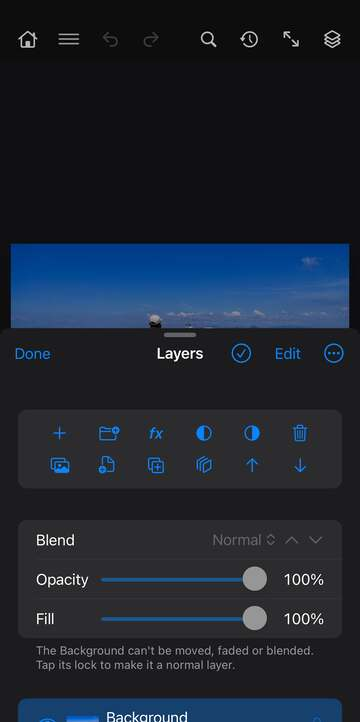
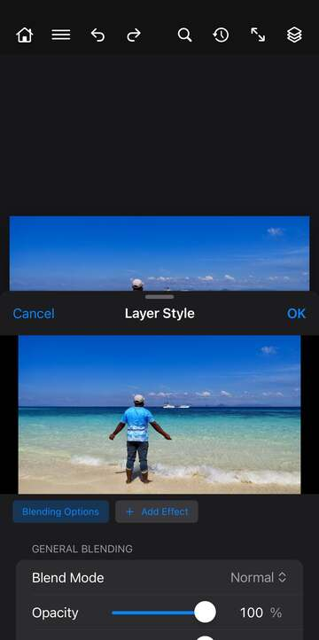

# Layers

A picture in PhotoWagon is a stack of layers, like sheets of clear film laid on top of each other. What's on a higher layer covers what's below it, unless you fade it, blend it or mask parts of it away. Keeping things on their own layers means you can change one part later without touching the rest.

## The Layers panel

Tap the layers button at the right of the top bar, or choose ☰ › Window › Layers. On a phone the panel opens at half height so you can still see the picture; drag it up for more room. On an iPad it opens as a full-height page.

### The buttons at the top

Two rows of buttons sit at the top of the panel and stay in view however far you scroll. Touch and hold any of them to see its name.

**New Layer** (+) adds an empty layer above the selected one.

**New Group** (folder) adds an empty group. If you've selected several layers, it puts them in a new group instead.

**fx** opens a menu of Blending Options… and every layer effect. Pick one to open Layer Style on that page (see [Layer Style](#layer-style)).

**New Fill or Adjustment Layer** (half-filled circle, right side dark) lists Solid Color, Gradient and Pattern fill layers and every adjustment layer. Pick one and it's added right away, with its Properties open so you can set it up.

**Add Mask** (half-filled circle, left side dark) adds a layer mask. Tap it to reveal everything, or to reveal only the selection if you have one. Touch and hold it for Hide All or Hide Selection instead. After you add a mask, painting goes on the mask.

**Delete Layer** (trash) deletes the selected layers. If the mask is selected, it asks whether to *Apply* the mask first (pixel layers only), *Delete* it, or *Cancel*.

**New Layer from Photos** and **New Layer from Files** open your photo library or the Files app and add the picture you choose as a new layer.

**Duplicate Layer** copies the selected layer. **Merge Down** merges the layer into the one below, or merges all of them if you've selected several. **Move Up** and **Move Down** move the layer one step in the stack.

### The bar at the very top

**Done** closes the panel. **Select Layers** (tick in a circle) turns on picking several layers: while it's on, each tap adds a layer to the selection or takes it out, and a tick shows beside each row. **Edit** shows drag handles for reordering. The **⋯** menu sets the *Thumbnail Size* (None, Small, Medium or Large), and has **Merge Visible** and **Flatten Image**.

### Blend mode, Opacity and Fill

Under the buttons are the settings for the selected layer. If several layers are selected, changes go to all of them.

**Blend** picks how the layer mixes with what's under it: Normal, Dissolve, the darkening modes (Darken, Multiply, Color Burn and so on), the lightening modes (Lighten, Screen, Color Dodge...), the contrast modes (Overlay, Soft Light, Hard Light...), Difference, Exclusion, Subtract, Divide, Hue, Saturation, Color and Luminosity. Groups also have Pass Through. The up and down arrows beside it step through the modes one at a time, so you can see what each one does.

**Opacity** fades the whole layer, effects included. **Fill** fades only the layer's own pixels, so its effects (like a stroke or a shadow) stay solid. Drag the slider, or drag sideways on the word itself to nudge the value.

The Background (the bottom layer of a new photo) can't be moved, faded or blended. Tap its lock to turn it into a normal layer.

### Layer rows

Each layer has a row. From left to right:

**The eye** shows or hides the layer.

**The arrow** (bent arrow) appears when the layer is clipped to the one below it. **The chevron** opens or closes a group, or shows and hides a layer's effects and live filters.

**The thumbnail** shows the layer's contents. Type layers show a "T", groups a folder. Embedded layers and shape layers carry a small badge. Tap the thumbnail to select the layer. Double-tap it to edit what the layer holds: the text of a type layer, the contents of an embedded layer, the Properties of a fill or adjustment layer, or the name of a pixel layer or group.

**The link and the mask thumbnail** appear when the layer has a mask. Tap the link to unlink the mask (so the layer and mask move on their own) or link it again. Tap the mask thumbnail to select the mask, so painting goes on it; it gets a coloured outline. Double-tap it for Mask Properties. A red cross on it means the mask is turned off.

**The name** and, under it, the blend mode and opacity (if they aren't the usual ones) or what kind of layer it is. Double-tap the name to rename the layer. Double-tap the empty space to the right of the name to open Layer Style at Blending Options.

**fx** shows the layer has effects. **The lock** shows the layer is locked; tap it to unlock.

### Reordering and groups

Tap **Edit**, then drag a layer by its handle to a new place. Drop it right under a group's row to put it into that group. You can also use **Move Up** and **Move Down**, or the layer's touch-and-hold menu (Move Into Group, Move Out of Group).

### Selecting several layers

Tap **Select Layers** at the top, then tap each layer you want. A strip appears with the count and quick buttons: **Merge**, **Group**, **Clip** (clip them to the lowest one), **Embedded Layer** (combine them into one embedded layer) and **Fit** (zoom to show them). Tap **Select Layers** again to stop.

### The layer's touch-and-hold menu

Touch and hold a layer's name or thumbnail for more. What you see depends on the layer:

**Rename…**, **Edit Text…** (type layers), **Edit Contents** (embedded layers), **Properties…** (fill and adjustment layers), **Blending Options…** and **Clear Layer Style**.

**Duplicate Layer**, and **Group Layers** or **Ungroup Layers**. If the layer has a mask, the mask's own items appear here too (see [Masks](#masks)).

**Merge Down** (or **Merge Layers** when several are selected), **Merge Visible**, and **Stamp Visible**, which adds a new layer holding a merged copy of everything you can see while keeping the other layers.

**Quick Export as PNG** saves the layer as a PNG, named after the layer, in the PhotoWagon folder in the Files app. With several layers selected it becomes **Quick Export Layers as PNG** and saves one file each.

**Convert to Embedded Layer**, **Rasterize Layer** (turns type, shapes, fills and embedded layers into plain pixels) and **Create Clipping Mask** or **Release Clipping Mask**.

**Show This Layer Only** hides every other layer; choose it again to bring them back. **Show/Hide All Other Layers** does the same as a toggle. **Fit Layer on Screen** zooms to the layer. **Select More Layers** turns on Select Layers with this one picked. **Background from Layer** makes this layer the Background. **Lock** or **Unlock**.

**Move Into Group** lists the groups to move it into. **Move Out of Group** takes it out of the group it's in. **Delete Layer** removes it.

### Effects and live filters under a layer

A layer with effects shows an **Effects** row under it, then a row for each effect. The eye on the Effects row hides or shows all of them, and each effect has its own eye. Double-tap an effect to change it in Layer Style. Swipe it left to delete it, or touch and hold for **Edit Effect…** and **Delete Effect**.

Embedded layers with filters show a **Live Filters** row and a row for each filter, covered in [Embedded layers and live filters](#embedded-layers-and-live-filters).

## Properties

Properties shows the settings of the selected layer. Open it from ☰ › Window › Properties, by double-tapping a fill or adjustment layer's thumbnail, or with **Properties…** in its touch-and-hold menu. Opened from the Window menu it sits beside the picture, so you can keep working on the canvas. Changes show as you make them.

**Adjustment layers** show the same settings screens as ☰ › Image › Adjustments, so you can change the adjustment at any time without touching the pixels underneath. Hue/Saturation has extras here: *Edit* (Master or one colour range), *Drag in the image to adjust* (drag sideways on a colour in the picture to change it), *Dragging changes* (Saturation or Hue), *Colorize*, and for a colour range the *Range* sliders (*Fade from*, *From*, *To*, *Fade to*).

**Solid colour fill layers** have **Pick Colour…** and **Pick from Image**, which samples a colour by tapping the picture (using the Eyedropper's sample settings).

**Gradient fill layers** show the gradient and these options: *Style* (Linear, Radial, Angle, Reflected, Diamond), *Angle*, *Scale*, *Reverse*, and a section of *Colour Stops* (tap a swatch to change its colour, slide to move it, swipe to delete, **Add Stop**), *Presets*, and *Opacity Stops* (each stop's opacity and location). In the Properties panel you can drag in the picture to move the gradient; from the Layers panel, tap **Move It in the Image** to get there.

**Shape layers** have **Pick Colour…** for the fill and, for rectangles, a *Corners* slider for rounding.

Under fill and adjustment layers' settings is a row of three buttons: **Clip to Layer Below** (the bent arrow, so the adjustment only affects that layer), **Reset to Defaults** (adjustment layers) and **Visibility** (the eye).

**Pixel, type and other layers** show the layer's kind and name, the document size, and **Quick Actions**. **Remove Background** finds the main subject and adds a mask that hides everything else. Your pixels aren't changed, so you can fix the mask later; a Background becomes a normal layer first. **Select Subject** selects the main subject. If the layer has a mask, a **Mask** section offers **Mask Properties**, **Disable / Enable Mask**, **Apply Mask** and **Delete Mask**.

When the mask is selected, Properties shows Mask Properties instead.

## The Adjustments panel

☰ › Window › Adjustments opens a small panel for the two adjustments you'll use most. Pick **Brightness/Contrast** or **Hue/Saturation** at the top, then move the sliders: *Brightness* and *Contrast*, or *Hue*, *Saturation* and *Lightness*. Your first change adds an adjustment layer, and later changes edit it. **Done** keeps it, **Cancel** takes it away again. For every other adjustment, use the New Fill or Adjustment Layer button in the Layers panel.

## Layer Style

Layer Style adds effects such as shadows, glows and outlines to a layer. They follow the layer's shape, so if you change the layer, the effects update. Open it from the **fx** button in the Layers panel, by double-tapping to the right of a layer's name, or from ☰ › Layer › Layer Style.

A row of buttons at the top lists **Blending Options** and each effect the layer has, with a tick box showing whether it's on. Tap one to see its settings. **Add Effect** adds another. On a phone, a preview of the picture sits above the settings. **OK** keeps your changes and **Cancel** undoes them all.

### Blending Options

*Blend Mode*, *Opacity* and *Fill Opacity* work like the ones in the Layers panel.

*Transparency Shapes Layer* (under Advanced Blending) decides whether the layer's see-through parts limit its effects and blending. Leave it on unless you want effects to fill the whole layer.

**Blend If** fades the layer out where it, or what's under it, is dark or bright. Pick *Gray* or a single colour channel, then drag the black and white handles on the *This Layer* and *Underlying Layer* bars. For example, drag the white handle of This Layer to the left to drop out the bright parts. Turn on *Split* to move each half of a handle on its own, which gives a soft fade instead of a hard edge.

### The effects

Each effect page has a switch to turn it on or off, its settings, and **Delete Effect**. Stroke, Inner Shadow, Color Overlay, Gradient Overlay and Drop Shadow can be added more than once with **Add Another**. Every slider has a box where you can type the value. Colours open the colour picker.

**Drop Shadow** casts a shadow behind the layer. Options: *Blend Mode*, *Color*, *Opacity*, *Angle*, *Use Global Light*, *Distance*, *Spread* (makes the edge harder), *Size* (blur), *Noise*, *Layer Knocks Out Drop Shadow* (hides the shadow under see-through parts of the layer). While its page is open, drag in the picture to move the shadow.

**Inner Shadow** puts a shadow inside the layer's edges, so it looks cut in. Options: *Blend Mode*, *Color*, *Opacity*, *Angle*, *Use Global Light*, *Distance*, *Choke*, *Size*, *Noise*. You can drag in the picture to move it too.

**Outer Glow** adds a glow around the outside. Options: *Blend Mode*, *Color*, *Opacity*, *Spread*, *Size*, *Range*, *Noise*.

**Inner Glow** adds a glow inside the edges. Options: *Source* (Edge or Center), *Blend Mode*, *Color*, *Opacity*, *Choke*, *Size*, *Noise*.

**Stroke** draws an outline. Options: *Position* (Outside, Inside, Center), *Blend Mode*, *Color*, *Opacity*, *Size*.

**Color Overlay** covers the layer with one colour. Options: *Blend Mode*, *Color*, *Opacity*.

**Gradient Overlay** covers the layer with a two-colour gradient. Options: *Style* (Linear, Radial, Angle, Reflected, Diamond), *Blend Mode*, *From*, *To*, *Opacity*, *Angle*, *Scale*, *Reverse*.

**Pattern Overlay** covers the layer with a pattern. Options: *Blend Mode*, *Opacity*, *Angle*, *Scale*.

**Bevel & Emboss** makes the layer look raised or pressed in. Options: *Style* (Inner, Outer, Emboss, Pillow, Stroke), *Technique* (Smooth, Chisel Hard, Chisel Soft), *Depth*, *Direction* (Up or Down), *Size*, *Soften*, *Angle*, *Use Global Light*, *Altitude* (how high the light is).

**Satin** adds soft, silky shading inside the layer. Options: *Blend Mode*, *Color*, *Opacity*, *Angle*, *Distance*, *Size*, *Invert*.

**Use Global Light** links the light angle of all effects that have it turned on, across the whole document, so shadows and bevels all agree. Change the angle on one and the others follow.

## Masks

A mask hides parts of a layer without erasing them. Where the mask is white the layer shows, where it's black the layer is hidden, and grey is in between. Paint on the mask in black to hide, in white to bring back. Because nothing is deleted, you can always change your mind.

**Adding a mask.** Tap **Add Mask** in the Layers panel, or use ☰ › Layer › Layer Mask. With a selection, the new mask shows only the selected area; touch and hold the button to hide the selected area instead.

**Painting on the mask.** Tap the mask thumbnail in the layer's row. It gets a coloured outline, and painting, filling and filters now work on the mask. Tap the layer thumbnail to go back to the pixels.

**The mask's touch-and-hold menu.** Touch and hold the mask thumbnail for these:

**View Mask** shows the mask alone on the canvas in black and white, with a bar saying "Showing the layer mask"; tap **Done** or **Stop Viewing Mask** to go back.

**Mask Properties…** opens the mask's settings (below).

**Disable Mask** turns the mask off for now without losing it, and **Enable Mask** turns it back on.

**Unlink Mask** lets you move the layer and its mask on their own; **Link Mask** joins them again.

**Invert Mask** swaps what's hidden and shown.

**Load as Selection** turns the mask into a selection.

**Copy Mask To** and **Move Mask To** put this mask on another layer you pick.

**Apply Mask** (pixel layers) makes the hiding permanent and removes the mask.

**Delete Mask** removes it.

**Mask Properties.** Double-tap the mask thumbnail, or open ☰ › Window › Properties while the mask is selected. *Density* fades the whole mask, so hidden parts show through a little. *Feather* softens the mask's edges, up to 1000 pixels. Neither changes what you painted, so you can adjust them later. Below are **Invert**, **Disable Mask**, **Unlink from Layer**, **Apply Mask** and **Delete Mask**.

**Vector masks** hide a layer using a path instead of pixels, so their edges stay sharp at any size. Add and remove them from ☰ › Layer › Vector Mask. They don't show a thumbnail in the Layers panel.

**Clipping masks** are another way to hide: a clipped layer only shows where the layer below it has pixels. It's handy for putting a photo inside text, or for making an adjustment affect only one layer. Use **Create Clipping Mask** from a layer's touch-and-hold menu or the Layer menu.

## Embedded layers and live filters

An **embedded layer** holds other layers, or a whole picture, inside it. You can scale, rotate and filter it as often as you like without losing quality, because PhotoWagon always works from the original inside. Embedded layers have a small badge on their thumbnail.

To make one, choose **Convert to Embedded Layer** from a layer's touch-and-hold menu, or select several layers and tap **Embedded Layer**. ☰ › File › Place Embedded… and Place from Photos… also add pictures as embedded layers.

To change what's inside, double-tap the thumbnail or choose **Edit Contents**. The contents open as a separate document. Make your changes, then save or close it, and the embedded layer updates.

**Live filters.** When you run a filter from ☰ › Filter on an embedded layer, it's added as a live filter instead of changing pixels for good. The filters are listed under the layer, newest on top. Tap a filter's eye to hide it. Double-tap it to change its settings; Fluid Warp opens on the canvas and Develop opens full screen. Swipe left to delete it. Touch and hold a filter for **Edit Live Filter…**, **Blending Options…** (a *Mode* and *Opacity* for how that filter's result mixes with the layer), **Copy to Layer** (adds the same filter to another embedded layer) and **Delete Live Filter**.

## The Layer menu

Choose ☰ › Layer. Items that can't be used right now are greyed out, with the reason written under them. Items ending in "…" ask for settings before they run.

### New

**Layer…** opens New Layer. Options: *Name*, *Use Previous Layer to Create Clipping Mask*, *Color* (a colour label for the row), *Mode*, *Opacity*, and *Fill with (mode)-neutral color*, which fills the layer with the colour that changes nothing in that mode (for example 50% grey for Overlay), ready to paint light and shade on.

**Group…** adds an empty group. Options: *Name*.

**New Type Layer** adds an empty type layer at the top-left corner. To type text, the Type tool is easier.

**New Shape Layer** is meant for adding a shape layer; draw shapes with the shape tools instead.

**Layer via Copy** copies the selected area to a new layer. **Layer via Cut** moves it to a new layer, leaving a hole.

**Layer From Background…** turns the Background into a normal layer you can move and fade. **Background From Layer** makes the selected layer the Background.

**Group from Layers…** puts the selected layers in a new group. Options: *Name*.

**Artboard…** adds an artboard, a separate canvas inside the document, handy for designing several screens or sizes side by side. Options: *Preset* (a phone, web or A4 size), *Name*, *Background* (White, Black, Transparent, Custom). **Artboard from Group…** turns a top-level group into an artboard. **Artboard from Layers…** puts the selected layers on a new artboard. Options: *Name*.

**Frame from Layers** groups the selected layers and clips them to a rectangle, like a picture frame.

**From Photos…** and **From Files…** add a picture from your photo library or the Files app as a new layer.

### Delete

**Delete Layer** removes the selected layers. **Hidden Layers** removes every layer whose eye is off.

### Arrange

**Bring Forward** and **Send Backward** move the layer one step up or down. **Bring to Front** and **Send to Back** move it to the top or bottom (the Background stays at the bottom). **Reverse** flips the order of the selected layers.

### Layer Mask

**Reveal All** and **Hide All** add a white or black mask. **Reveal Selection** and **Hide Selection** add a mask that shows or hides the selected area. **From Transparency** makes a mask from the layer's see-through areas.

**Delete** removes the mask, and **Apply** makes it permanent. **Disable Layer Mask** turns the mask off or back on. **Unlink Layer Mask** unlinks it from the layer or links it again.

### New Fill Layer

A fill layer is a layer filled with a colour, gradient or pattern that you can change later. If you have a selection, it becomes the layer's mask.

**Solid Color…** Options: *Color*.
**Gradient…** Options: *From*, *To*, *Angle*, *Style*, *Reverse*.
**Pattern…** Options: *Scale*, *Angle*, *Link* (moves the pattern with the layer).

### New Adjustment Layer

An adjustment layer changes the colours and tones of everything under it, without changing any pixels, so you can tweak or remove it at any time. If you have a selection, it becomes the layer's mask. Clip the adjustment layer to the layer below if you want it to affect only that one.

**Brightness/Contrast…, Levels…, Curves…, Exposure…, Vibrance…, Hue/Saturation…, Color Balance…, Black & White…, Photo Filter…, Channel Mixer…, Invert, Posterize…, Threshold…, Gradient Map…, Selective Color…, Color Lookup…** each add that adjustment. From this menu they first ask for a few starting settings (for example *Levels* for Posterize, *Level* for Threshold, *Brightness* and *Contrast* for Brightness/Contrast). For the full settings, open the new layer's Properties. The New Fill or Adjustment Layer button in the Layers panel skips the first step and opens Properties straight away.

### Layer Style

**Drop Shadow…, Inner Shadow…, Outer Glow…, Inner Glow…, Stroke…, Color Overlay…, Gradient Overlay…, Pattern Overlay…, Bevel & Emboss…, Satin…** open Layer Style on that effect, adding it if the layer doesn't have it yet. **Blending Options…** opens Layer Style at Blending Options.

**Clear Layer Style** removes all effects and blending options from the selected layers.

**Copy Layer Style** and **Paste Layer Style** copy a layer's effects and paste them onto the selected layers.

**Hide All Effects** hides the effects of every layer, or shows them again.

**Global Light…** sets the light direction shared by effects that use it. Options: *Angle*, *Altitude*.

**Create Layer** turns each effect into its own pixel layer, so you can paint on or move a shadow by itself.

**Scale Effects…** makes all of the layer's effects bigger or smaller, for example after resizing the layer. Options: *Scale* (percent).

### Rasterize

Rasterizing turns a special layer into plain pixels, so you can paint on it. You can't edit it the old way after that.

**Rasterize Type** and **Type** turn type into pixels. **Rasterize Shape** turns a shape into pixels. **Layer** rasterizes the selected layer, whatever kind it is. **All Layers** does every layer in the document. **Fill Content** rasterizes a fill layer. **Embedded Layer** turns an embedded layer into pixels, live filters included. **Video** rasterizes a video layer. **Layer Style** bakes the effects into the layer's pixels.

### Vector Mask

**Add Vector Mask** adds a vector mask that shows everything. **Vector Mask from Current Path** makes one from the work path. **Delete Vector Mask** removes it.

### Embedded Layers

**Convert to Embedded Layer** wraps the selected layers into one embedded layer. **New Embedded Layer via Copy** makes a copy whose contents are separate, so editing one doesn't change the other.

**Rasterize** turns the embedded layer into plain pixels. **Edit Contents** opens what's inside as its own document; save or close it to update the layer. **Convert to Layers** unpacks it back into normal layers (its live filters are dropped).

**Update Modified Content**, **Update All Modified Content** and **Convert to Embedded** are for embedded layers that point to a file outside the document. **Reveal in Finder** isn't available on iPhone and iPad.

**Warp**, **Pin Warp** and **Perspective Warp** bend an embedded layer while keeping it editable. From this menu they have no handles to drag; to place pins by hand, use ☰ › Edit › Pin Warp.

**Stack Mode** combines the layers inside an embedded layer pixel by pixel. It's useful for a set of photos taken from the same spot: **Median** or **Mean** removes people or cars that moved between shots and reduces noise. The other choices are **Entropy, Kurtosis, Maximum, Minimum, Range, Skewness, Standard Deviation, Summation** and **Variance**. **None** turns it off.

### Live Filter

**Disable Live Filters** hides all of the embedded layer's live filters, or shows them again. **Clear Live Filters** removes them all.

**Delete Filter Mask** and **Disable Filter Mask** remove, or turn off and on, the mask that limits where the live filters apply.

**Blending Options…** sets how the top live filter mixes with the layer, by mode name and an opacity from 0 to 1. Touching and holding the filter in the Layers panel gives a friendlier version of the same thing.

### Align

**Top Edges, Vertical Centers, Bottom Edges, Left Edges, Horizontal Centers, Right Edges** line up the selected layers by that edge or centre. If there's a selection, they line up with the selection. One layer on its own lines up with the canvas.

### Distribute

**Top Edges, Vertical Centers, Bottom Edges, Left Edges, Horizontal Centers, Right Edges** space three or more selected layers so that edge or centre is evenly spread. **Horizontally** and **Vertically** make the gaps between them equal.

### Matting

These clean up the edges of a cut-out layer.

**Defringe…** replaces the colour of edge pixels with colours from right inside, which removes a halo of the old background. Options: *Width* (in pixels).

**Remove Black Matte** and **Remove White Matte** fix soft edges that were cut out from a black or white background.

**Color Decontaminate…** pulls edge colours towards the nearby solid colours. Options: *Amount*, *Radius*.

### Video Layers

A video layer holds a series of frames, which you can play in ☰ › Window › Timeline.

**New Blank Video Layer** adds one. **Insert Blank Frame**, **Duplicate Frame** and **Delete Frame** work on the current frame. **Restore Frame** and **Restore All Frames** undo your painting on one or all frames. **Show Altered Video** shows or hides your changes. **Rasterize** turns the current frame into a normal layer. **Interpret Footage…** and **Reload Frame** are for video loaded from a file. **New Video Layer from File…** and **Replace Footage…** need a file and don't work from this menu yet.

### The rest of the Layer menu

**Group Layers** puts the selected layers in a group, and **Ungroup Layers** takes them out again.

**Duplicate Layer…** copies the selected layers. Options: *In place* (for artboards, keeps the copy on the same artboard), *Name*, *Document name*.

**Create Clipping Mask** clips the layer to the one below, and **Release Clipping Mask** undoes it.

**Merge Down** merges the layer into the one below. **Merge Layers** merges the selected layers into one. **Merge Group** merges a group into a single layer. **Merge Visible** merges every visible layer. **Flatten Image** merges everything into a single Background.

**Hide Layers** hides the selected layers, or shows them if they're all hidden.

**Link Layers** links the selected layers so they move together; choose it again to unlink. **Select Linked Layers** selects every layer linked to this one.

**Lock Layers…** locks parts of the selected layers so you can't change them by mistake. Options: *Transparency* (paint only where there are pixels already), *Pixels* (no painting), *Position* (no moving), *Artboard*, *All*. A lock shows on the layer's row; tap it to unlock.

**Rename Layer** doesn't ask for a name from here. To rename a layer, double-tap its name in the Layers panel.

**Mask All Objects** finds the main objects in the layer and masks the layer to them, hiding everything else.

**Layer Content Options…** has nothing to show here. To change a fill, adjustment or shape layer, open its Properties.

**New Layer Based Slice** adds a slice that follows the layer's outline, effects included.

## Tips

- **Name your layers.** Double-tap a name to rename it. It makes a busy stack much easier to follow.
- **Use adjustment layers instead of ☰ › Image › Adjustments** when you might want to change your mind. You can always change them later, hide them, or paint on their mask to limit where they apply.
- **Mask instead of erasing.** A mask hides pixels without deleting them, so you can bring them back.
- **Touch and hold** any Layers panel button to see its name, and any layer, mask, effect or filter for more choices.
