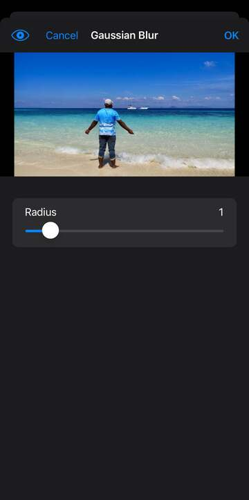
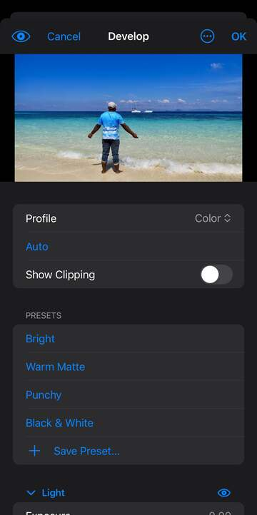

# Filters and Develop

Filters change the pixels of a layer: blur it, sharpen it, add noise, bend it or paint it in a new style. You'll find them all under ☰ › Filter. Develop is a full photo-finishing screen for light, colour and detail, and it's also where camera raw files open.

## How filter settings work

**Running a filter.** Pick the layer you want to change in the Layers panel, then choose a filter from ☰ › Filter. If there's a selection, only the selected part changes. Items without "…" at the end run straight away with no questions.

**The settings sheet.** Items ending in "…" open their settings first. On an iPhone they open in a sheet with a small preview of the image at the top. On an iPad they open in a column beside the canvas, so you see the change on the full image. Each number has a slider and a box you can type in; choices are lists and switches are toggles.

**Trying settings.** The filter is tried each time you let go of a slider, enter a number or pick a choice. A spinner shows while it works. Tap **OK** to keep the result, or **Cancel** to put the image back as it was. Swiping the sheet away is turned off, so you never keep a try by accident.

**Preview.** The eye button at the top left of the sheet turns the preview off and on. Off shows the image without the filter, so you can compare before and after without losing your settings.

**Handles on the preview.** Tilt-Shift, Iris Blur, Spin Blur, Path Blur and Lighting Effects show handles on the image. Drag them to place the centre, the edges, the ends or the light. The other settings sit in the form below.

**Last Filter.** ☰ › Filter › Last Filter runs the most recent filter again, with the same settings, on the layer you have selected now. With a keyboard, press ⌘⌥F.

**Filter Gallery…** Stacks several artistic effects and applies them together. The list starts with one effect. Tap an effect for its settings, tap its eye to hide it, hold it for **Move Up** and **Move Down**, and swipe it to remove it. **Add Effect** adds another one. Effects are applied from top to bottom.

The gallery's effects, by group: Artistic (Colored Pencil, Cut Paper, Dry Brush, Film Grain, Fresco, Neon Glow, Paint Daubs, Palette Knife, Plastic Wrap, Poster Edges, Rough Pastels, Smudge Stick, Sponge, Underpainting, Watercolor), Brush Strokes (Accented Edges, Angled Strokes, Crosshatch, Dark Strokes, Ink Outlines, Spatter, Sprayed Strokes, Sumi-e), Distort (Diffuse Glow, Glass, Ocean Ripple), Sketch (Bas Relief, Chalk & Charcoal, Charcoal, Chrome, Conté Crayon, Graphic Pen, Halftone Pattern, Note Paper, Photocopy, Plaster, Reticulation, Stamp, Torn Edges, Water Paper), Stylize (Glowing Edges) and Texture (Craquelure, Grain, Mosaic Tiles, Patchwork, Stained Glass, Texturizer). Some of them use your foreground and background colours.

## Live filters

**Live filters.** A filter applied to an embedded layer doesn't change its pixels for good. It's kept as a live filter that you can change, hide or remove later. Live filters are listed under the layer's row in the Layers panel, under "Live Filters". Tap the arrow on the layer's row to show them.

**Convert for Live Filters.** ☰ › Filter › Convert for Live Filters turns the selected layer (or several selected layers together) into one embedded layer, ready for live filters.

**Changing a live filter.** In the Layers panel, tap a live filter's eye to hide or show it, and double-tap it to change its settings. Fluid Warp opens on the canvas again and Develop opens its own screen. Swipe a live filter to delete it.

**More for a live filter.** Hold a live filter for **Edit Live Filter…**, **Blending Options…**, **Copy to Layer** (puts a copy on another embedded layer) and **Delete Live Filter**.

**Blending Options.** Sets how a live filter's result mixes with the layer under it. Options: *Mode* (the blend mode), *Opacity* (how strongly the filter shows, 0 to 100%).

## Filter menu: the top

**Last Filter, Filter Gallery…, Convert for Live Filters.** See the sections above.

**Lens Correction…** Fixes what a camera lens does to a photo: bent lines, dark corners and coloured fringes, plus tilt and rotation. With a keyboard, press ⌘⇧R. Options: *Profile* (None, Auto or Generic), *Focal length* (in mm), *Correct distortion*, *Correct vignette*, *Correct c a* (colour fringes), *Auto scale*, *Distortion*, *Red cyan* and *Blue yellow* (fringe fixes), *Vignette amount*, *Vignette midpoint*, *Vertical* and *Horizontal* (perspective), *Angle*, *Scale*, *Edge* (what fills the gaps: Transparency, Edge extension, Black or White).

**Develop…** Opens Develop on the selected layer. See "Develop" below. With a keyboard, press ⌘⇧A.

**Perspective Planes…** Meant for pasting and cloning along a surface in perspective. Its sheet only has *Focal length* and *New layer* so far, with no way to draw a plane, so it can't do anything useful yet.

**Fluid Warp…** Push, pull, twist and swell parts of a layer by painting on the canvas. Pick the tool in the options bar, then drag on the image; two fingers still zoom and pan. Tap ✓ (Commit) to keep the warp or ✕ (Cancel) to drop it. With a keyboard, press ⌘⇧X.

Fluid Warp's options bar: *Tool* (Forward Warp pushes pixels along your stroke, Reconstruct paints them back, Smooth evens out the warp, Twirl turns them clockwise, Pucker pulls them in, Bloat pushes them out), *Size* (10 to 1000 pixels), *Pressure* (how strong each stroke is). Under **More**: *Amount* (how much of the warp shows, from 100% down to 0%) and **Restore All** (start again).

## Blur

**Gaussian Blur…** A smooth, even blur. Good for softening a background or a mask. Options: *Radius* (how far the blur spreads, in pixels).

**Blur, Blur More.** A light blur with no settings. Blur More is a few times stronger.

**Box Blur…** Blurs with square averaging, which looks a little blocky in highlights. Options: *Radius*.

**Motion Blur…** Streaks the image in one direction, as if it moved. Options: *Angle* (the direction), *Distance* (how long the streaks are).

**Radial Blur…** Blurs in circles round a point, or out from it like a zoom. Options: *Amount*, *Method* (Spin or Zoom), *Quality* (Draft, Good or Best), *Center x* and *Center y* (where the centre is, 0 to 1 across and down the image).

**Surface Blur…** Smooths flat areas but keeps edges sharp. Handy for skin and noise. Options: *Radius*, *Threshold* (how different pixels must be to count as an edge).

**Smart Blur…** Blurs inside areas of similar colour and can show the edges it finds. Options: *Radius*, *Threshold*, *Quality* (High, Medium or Low), *Mode* (Normal, Edge only, Overlay edge).

**Lens Blur…** Imitates a camera's out-of-focus blur, with shaped highlights. Options: *Radius*, *Shape* (Hexagon, Triangle, Square, Pentagon, Heptagon or Octagon), *Blade curvature*, *Rotation*, *Depth map* (None, Transparency or Layer mask), *Focal distance*, *Invert*, *Brightness* and *Threshold* (for bright spots), *Noise*, *Distribution* (Uniform or Gaussian), *Monochromatic*.

**Shape Blur…** Blurs using a shape, which shows in bright spots. Options: *Radius*, *Shape* (Circle, Ring, Square, Diamond, Triangle, Hexagon, Star, Heart or Cross).

**Average.** Fills the layer, or the selection, with its average colour. No settings. Useful for finding the overall colour of an area.

## Sharpen

**Sharpen, Sharpen More.** Quick sharpening with no settings. Sharpen More is stronger.

**Sharpen Edges.** Sharpens only the edges and leaves smooth areas alone. No settings.

**Unsharp Mask…** Classic, controllable sharpening. Options: *Amount* (how strong, in percent), *Radius* (how wide the sharpened edges are), *Threshold* (leave areas this smooth alone, so noise isn't sharpened).

**Smart Sharpen…** Sharpening that also holds back noise. Options: *Amount*, *Radius*, *Reduce noise*.

## Noise

**Despeckle.** Removes fine specks and grain while keeping edges. No settings.

**Add Noise…** Adds grain, for a film look or to hide banding. Options: *Amount*, *Distribution* (Uniform or Gaussian), *Monochromatic* (grey grain instead of coloured).

**Median…** Replaces each pixel with the middle value of its neighbours, which wipes out specks. Options: *Radius*.

**Dust & Scratches…** Removes small marks that stand out from their surroundings. Options: *Radius* (how big a mark can be), *Threshold* (how different it must be).

**Reduce Noise…** Cleans up grainy photos. Options: *Strength*, *Preserve details*, *Reduce color noise*, *Sharpen details*, *Remove jpeg artifact* (smooths the blocks of heavily squeezed JPEGs).

## Pixelate

**Mosaic…** Turns the image into square blocks. Options: *Cell size*.

**Color Halftone…** Turns the image into printed-looking dots, one screen per colour. Options: *Max radius* (the biggest dot), *Channel1* to *Channel4* (the angle of each colour's dots).

**Crystallize…** Breaks the image into flat, crystal-shaped cells. Options: *Cell size*.

**Facet.** Groups similar pixels into flat patches, a little like a painting. No settings.

**Fragment.** Overlays four offset copies for a shaky, doubled look. No settings.

**Mezzotint…** Turns the image into a pattern of dots, lines or strokes. Options: *Type* (Fine dots, Medium dots, Grainy dots, Coarse dots, Short lines, Medium lines, Long lines, Short strokes, Medium strokes or Long strokes).

**Pointillize…** Paints the image in dots of colour over the background colour. Options: *Cell size*.

## Stylize

**Emboss…** Makes the image look raised or stamped into grey metal. Options: *Angle* (where the light comes from), *Height*, *Amount*.

**Find Edges.** Outlines the edges in the image on white. No settings.

**Solarize.** Blends a negative with the positive, like a photo exposed to light while developing. No settings.

**Diffuse…** Scatters pixels for a soft, frosted look. Options: *Mode* (Normal, Darken only, Lighten only or Anisotropic).

**Extrude…** Pushes the image out into 3D blocks or pyramids. Options: *Type* (Blocks or Pyramids), *Size*, *Depth*, *Depth mode* (Random or Level based), *Solid front faces*, *Mask incomplete blocks*.

**Oil Paint…** Makes a photo look painted with thick brush strokes. Options: *Stylization*, *Cleanliness*, *Scale*, *Bristle detail*, *Lighting* (shows the paint's ridges), *Angle* (of the light), *Shine*.

**Tiles…** Cuts the image into tiles and nudges them apart. Options: *Count* (tiles across), *Max offset*, *Fill* (what shows in the gaps: Background, Foreground, Inverse or Unaltered).

**Trace Contour…** Draws thin lines where brightness crosses a level, like a contour map. Options: *Level*, *Edge* (Lower or Upper).

**Wind…** Adds streaks as if wind blew across the image. Options: *Method* (Wind, Blast or Stagger), *Direction* (From right or From left).

## Distort

**Twirl…** Spins the image round its centre, more in the middle than at the edges. Options: *Angle*.

**Pinch…** Squeezes the middle in, or pushes it out with a negative amount. Options: *Amount*.

**Spherize…** Wraps the image round a ball, for a bulging look. Options: *Amount*, *Mode* (Normal, Horizontal only or Vertical only).

**Wave…** Ripples the image with mixed waves. Options: *Generators* (how many waves), *Wavelength min* and *Wavelength max*, *Amplitude min* and *Amplitude max*, *Type* (Sine, Triangle or Square), *Undefined areas* (Wrap or Repeat).

**Ripple…** Small ripples like the surface of water. Options: *Amount*, *Size* (Small, Medium or Large).

**Polar Coordinates…** Bends a strip into a circle, or opens a circle out into a strip. Options: *Mode* (Rectangular to polar or Polar to rectangular).

**Displace…** Moves pixels by the brightness of another image (the map), for example to make a picture follow the folds of cloth. Open the map as a document first. Options: *Displacement Map* (which open document), *Horizontal* and *Vertical* (how far), *Fit* (Stretch or Tile), *Undefined areas* (Repeat or Wrap).

**Shear…** Bends the image sideways along a curve. Drag the line in the graph sideways and tap it to add a point; **Reset** makes it straight again. Options: *Undefined Areas* (Wrap Around or Repeat Edge Pixels).

**ZigZag…** Ripples out from the centre, like a stone dropped in a pond. Options: *Amount*, *Ridges*, *Style* (Pond ripples, Out from center or Around center).

## Other

**High Pass…** Keeps only edges and fine detail, greying the rest. Often set to Overlay for sharpening. Options: *Radius*.

**Minimum…, Maximum…** Minimum grows the dark areas and Maximum grows the light ones. They're useful for shrinking or spreading a mask. Options: *Radius*, *Preserve* (Squareness or Roundness).

**Offset…** Slides the image across, by a number of pixels. Options: *Horizontal*, *Vertical*, *Undefined areas* (what fills the gap: Wrap, Repeat or Transparent).

**Custom…** Applies your own sharpening or blurring pattern. Its sheet only shows *Scale* and *Offset*, with no grid to enter the pattern, so it isn't much use yet.

**HSB/HSL.** Swaps how the colour is stored in the pixels, from RGB to hue, saturation and brightness. It runs straight away with no settings, and the result looks strange on its own.

**Color to Alpha…** Turns a colour into transparency, for example to lift a drawing off white paper. Soft edges stay soft. Options: *Color* (the colour to remove), *Transparency threshold*, *Opacity threshold*.

## Render

**Fibers…** Draws a woven fibre texture in your foreground and background colours. Options: *Variance* (how much the colour changes), *Strength* (how long the fibres are).

**Lens Flare…** Adds the bright glare a camera lens catches from a light. Options: *Brightness*, *Center x* and *Center y* (where the flare is), *Lens* (Zoom, Prime35, Prime105 or Movie prime).

**Lighting Effects…** Shines a light on the image. Drag the yellow handle for the light and the white one for where it points. Options: *Light type* (Spot, Point or Infinite), *Intensity*, *Light z* (height), *Cone*, *Hotspot*, *Angle*, *Elevation*, *Gloss*, *Metallic*, *Exposure*, *Ambience*, *Texture* (None, Red, Green, Blue, Alpha or Luminance, for bumps), *Height*, *White is high*.

**Relight…** Changes where the light seems to fall on a photo, keeping its detail. Options: *Angle* and *Elevation* (where the new light comes from), *Intensity*, *Ambient* (light from everywhere), *Warmth*, *Softness*.

**Clouds, Difference Clouds.** Clouds fills the layer with soft clouds in your foreground and background colours. Difference Clouds blends clouds into what's there, flipping colours. No settings.

**Picture Frame…** Draws a decorative frame round the image. Options: *Frame* (Vine with flowers, Vine with leaves, Ivy, Roses, Daisies, Berries, Bamboo, Waves, Zigzag, Dots, Rope, Scallops, Double line, Snowflakes, Stars or Hearts), *Margin*, *Size*, *Arrangement*, *Lines*, *Thickness*, *Fade*, *Vine color*, *Flower color*, *Leaf color*, *New layer*.

**Tree…** Draws a tree. Options: *Base tree type* (1 to 34), *Light direction* (1 to 5), *Leaves amount*, *Leaves size*, *Branches height*, *Branches thickness*, *Default leaves*, *Leaves color*, *Custom branch color*, *Branches color*, *Flat shading*, *X* and *Y* (where it stands), *Size*, *New layer*.

## Blur Effects

**Tilt-Shift…** Keeps a band sharp and blurs above and below it, so a scene looks like a model. Drag the handle to move the band. Options: *Blur*, *Angle*, *Focus* (how wide the sharp band is), *Transition* (how gently it fades).

**Iris Blur…** Keeps an oval sharp and blurs round it. Drag the centre handle to move it and the two edge handles to size it. Options: *Blur*, *Angle*, *Roundness*, *Feather*.

**Variable Blur…** Blurs more where the selection is stronger, so you can paint where the blur goes. Options: *Radius*, *Mask* (the name of a saved selection to use instead).

**Spin Blur…** Spins an oval area, like a turning wheel. Drag the handles to place and size it. Options: *Blur angle* (how far it spins), *Angle*.

**Path Blur…** Blurs along a line, as if the subject moved. Drag the start and end handles. Options: *Speed*.

## Video

**De-Interlace…** Removes the comb-like lines from a frame grabbed from video. Options: *Eliminate* (Odd fields or Even fields), *Create by* (Interpolation or Duplication).

**NTSC Colors.** Tones colours down to what old TV broadcasts can show. No settings.

## Plug-ins

**Install Plug-in…** Asks for a *Path* to a plug-in file and has a *Replace* switch. On iPhone and iPad there's no way to pick the file yet.

## Develop

Develop is a full screen for finishing photos: light, colour, curves, detail, presets and snapshots, with the image at the top. Open it from ☰ › Filter › Develop… to work on the selected layer.

**Opening files in Develop.** Camera raw files (such as DNG, CR2, CR3, NEF, ARW, RAF, ORF, RW2 and PEF) always open in Develop first. To open JPEG and HEIC photos there too, turn on *Open JPEG and HEIC in Develop* in ☰ › Edit › Preferences › General…, under File Handling.

**Open, Open as Object, Done.** When a file opens in Develop, tap **Open** to open it with your settings applied. Hold **Open** for **Open as Object**, which opens it as an embedded layer with Develop as a live filter you can change later. **Done**, in the ⋯ menu, keeps your settings for the next time you open that file, and closes it without opening. **Cancel** closes it.

**Workflow.** Shown only while opening a file, and applied when you tap Open. Options: *Color Space* (As Opened, sRGB, Display P3, Adobe RGB (1998) compatible or ProPhoto RGB compatible), *Depth* (As Opened, 8 Bits/Channel or 16 Bits/Channel).

**OK and Cancel.** When Develop is opened from the Filter menu or from a live filter, **OK** keeps the result and **Cancel** puts things back.

**Trying settings.** The image updates each time you let go of a control. The eye button at the top left shows the image before and after your settings.

**Undo, Redo, Reset to Default.** Under the ⋯ button at the top right. Undo and Redo step through your changes in Develop. Reset to Default sets everything back but keeps your snapshots.

**Profile.** *Color* or *Monochrome* (black and white).

**Auto.** Sets the Light sliders for you from the image's brightness. Change them after if you like.

**Show Clipping.** Outlines the parts of the image that are pure black (in cyan) or pure white (in red).

**Sliders.** Double-tap a slider's name to reset it. Hold the name for **Reset** and, where there is one, **Auto** for that slider alone.

**Panels.** The settings are grouped in panels. Tap a panel's name to open or close it, and tap its eye to turn its settings off and on, to compare.

**Light.** Brightness and contrast. Options: *Exposure* (overall brightness, in stops), *Contrast*, *Highlights* (bright areas), *Shadows* (dark areas), *Whites* (the very brightest), *Blacks* (the very darkest).

**Color.** White balance and colour strength. Options: *White Balance* (As Shot, Auto or Custom), **White Balance Tool** (hold on the image, then let go on something that should be grey), *Temperature* (cooler or warmer), *Tint* (green or magenta), *Vibrance* (boosts dull colours more than strong ones), *Saturation*.

**Effects.** Finishing touches. Options: *Texture* (fine detail), *Clarity* (mid-size contrast), *Dehaze* (cuts or adds haze), *Vignette* (darkens or lightens the corners) with *Midpoint*, *Roundness* and *Feather*, *Grain* with *Size* and *Roughness*.

**Curve.** A tone curve over the image's histogram. Pick *RGB*, *Red*, *Green* or *Blue*, then tap the curve to add a point and drag points to move them. Drag a point off the graph to remove it.

**Color Mixer.** Changes one range of colours at a time. Pick *Hue*, *Saturation* or *Luminance*, then move the slider for *Red*, *Orange*, *Yellow*, *Green*, *Aqua*, *Blue*, *Purple* or *Magenta*.

**Detail.** Sharpening and noise. Options: *Sharpening* with *Radius*, *Detail* and *Masking* (sharpen only the edges), *Noise Reduction* with *Detail*, *Color Noise Reduction* with *Detail*.

**Presets.** One tap applies a look: Bright, Warm Matte, Punchy or Black & White, plus any you've saved. After you pick one, *Amount* (0 to 200%) makes it weaker or stronger. **Save Preset…** saves your current settings under a name.

**Snapshots.** **Save Snapshot…** saves the current settings under a name, so you can try other ideas and come back. Tap a snapshot to go back to it. Snapshots are kept with the image's Develop settings.
